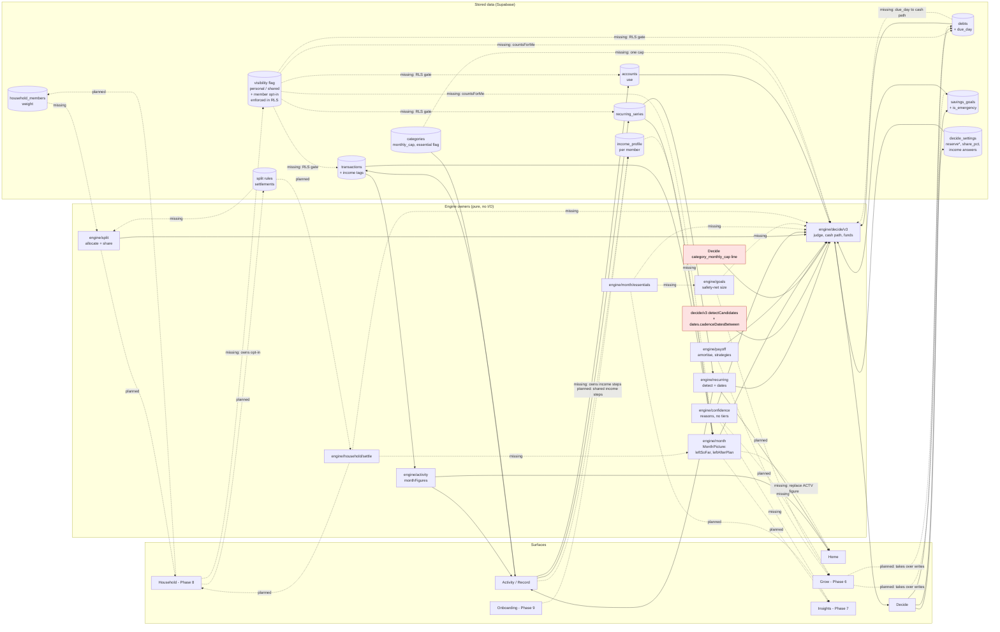

# Decide Fix Plan: FincWin United

**For:** the app owner
**Date:** 31 October 2026
**From:** the fix-plan team (financial, engine, architecture, mobile app, UX and compliance experts), combined by the lead editor
**Based on:** today's Decide audit (overall about 6/10, themes A to F, 21 must-fix items) and your seven settled decisions
**Status:** approved by the owner on 1 November 2026. Phases 05.4, 05.5, 08.1 and 08.2 are in ROADMAP.md, and Phases 6, 7 and 8 carry its amendments. Theme M (four safeguards against repeat errors) was added and approved on 1 November 2026. Theme N (build Decide once: 05.3 stopped, Variant C built from scratch in 08.1 on fixed foundations) was approved on 1 November 2026 after a six-expert review. Theme O (the Variant C audit and the version 1 scope) was added on 1 November 2026.

---

## 1. The short version

- **The goal is 10/10 from every auditor.** Six auditors scored Decide today: financial, engine, app, UI, UX and compliance. The plan adds a seventh, an integration auditor, who checks that Decide, Activity, Grow and Household share data without copying it. Each auditor has a checklist (section 7). Decide is switched on for the public only when every line is ticked, or you sign a waiver for a gap.
- **Build Decide once (Theme N, added 1 November).** The Calm Ledger screens (05.3) stop and their branch is parked. Its engine fixes and shared plumbing come onto main in 05.4. The engine is fixed and proven with no screens. Six connection points, each owned by one feature, are written in 05.5. Grow and Household are built to them, designed for Variant C. Then the Variant C screens are built once, from scratch, in 08.1. Decide stays off for everyone, testers included, until then, and testers' real records are run through the engine quietly instead.
- **What version 1 contains (Theme O, added 1 November).** Version 1 is the full Variant C Decide, built once in 08.1, including the decision record. Home buying is its own phase after 08.2. Reminders, search, bank sync and checking a price from outside the app are in v1.1. Before reading-test round 1, the mockups get a fourth round of fixes from the full audit: money mistakes, 14 missing states and copy that instructs.
- **Build order in one line:** 05.3 stopped (branch parked) → **05.4 safety patch** → **05.5 one shared money model** → **Grow** → **Household** → **08.1 Decide rebuild** → **08.2 re-audit** → Insights → Tiers, System, Compliance.
- **Why this order:** the "says Fits when it shouldn't" bugs get fixed and locked by automatic tests in the first few weeks. Every later phase is then checked against a correct engine. The bigger rebuild still waits for real goals, debts and household data, as you wanted.
- **The safety net:** Decide keeps a safety net (emergency fund) out of spendable money by default. The starter size is about 1 month of your essential costs, worked out from your records. Later the app suggests 3 months. A purchase that dips into it gets its own amber answer: "Fits, but dips into your safety net." You can resize it or switch protection off at any time. Nothing is forced.
- **Rough / Fair / Firm is gone.** Every answer carries one plain sentence: what it is based on, and what would make it surer. Example: "Based on 2 months of your records. Logging 1 more month makes this surer." Typed-in figures are now called **"quick estimates"** on screen.
- **A household privacy gap must close before anyone can be invited.** Today the database lets any household member read every record in that household. That is harmless while every household has one person. The day a partner joins, they would see everything. Household's first job is to make every record **personal unless marked shared**, enforced by the database itself.
- **Why Decide needed so many fixes, and how this plan stops it (Theme M, added 1 November).** The design kept changing after code was written (18 revisions of the screen spec, and an engine rewrite after the screens were built). The tests checked that the app matched the design prototype, not that its answers were right, so too-kind rules passed with every line tested. Four safeguards fix this: **freeze the design** after reading-test round 1; **write the right answers first** in a table you approve; **check the engine against a second, simple calculator** on thousands of random cases; and **test the tests** by breaking the engine on purpose and making sure a test fails each time.
- **How long:** roughly **16 to 20 weeks of fix work**, spread across the build (Theme N moves the screen build into 08.1 and drops the rest of 05.3). About 7.5 to 9.5 weeks of it come before Grow starts (05.4 and 05.5). The rest is added to Grow and Household, plus a 3 to 4 week Decide rebuild and about 1 week of re-audit. These are on top of the work Grow and Household already need. Public launch also waits on Apple enrolment and Phases 9 to 11.
- **What you must decide:** 13 questions (section 11). Question 2 is already settled, and question 13, about tax and running costs, was added on 1 November. The most important ones: approve the order, accept amber "dips into your safety net" answers, and agree the household privacy defaults. Five topics need a lawyer.

---

## 2. Words you'll see

| Word | What it means here |
|---|---|
| **Decide** | The tab where you type an item and a price and the app tells you whether it fits your money. |
| **Verdict** | Decide's answer, such as "Fits this month", "Not yet" or "Short each month". |
| **Fits** | The answer that says the purchase can be covered. After this plan, a plain "Fits" means it leaves your safety net untouched and does not rely on borrowing or on your word alone. |
| **Caution answer** | An amber answer that still fits, but with a catch, for example "Fits, but dips into your safety net" or "Fits only by borrowing". |
| **Tone symbol** | A small shape beside each answer (tick, half circle, clock, circle with a dash, question mark, shield) so answers can be told apart without relying on colour. |
| **Engine** | The part of the app that does the maths. It has no screens. Numbers go in, an answer comes out. |
| **Snapshot builder** | The code that turns your stored records into the numbers the engine reads (`buildV3Inputs.ts`). |
| **Cash path** | The engine's day-by-day forecast of your everyday balance for the next 90 days, with pay on paydays and bills on due dates. Its lowest day is the "lowest point". |
| **Safety net** | Money kept aside for real surprises, also called an emergency fund. Decide does not count it as spendable unless you switch protection off or mark a purchase as an emergency. |
| **Essential costs** | Your share of regular bills, plus debt minimum payments, plus typical spending in essential categories (groceries, utilities, transport, health, childcare, insurance, housing). The starter safety net is 1 month of these. |
| **Spare money** | Money left from earlier months that is not set aside for anything. Today's screens call it "unspent money". It is being renamed. |
| **Overdraft** | When an account goes below zero. Today the engine treats it as zero, which is wrong. |
| **APR** | The yearly interest rate on a loan or card. |
| **Confidence sentence** | The plain line under each answer that says what the answer rests on and how to make it surer. It replaces Rough / Fair / Firm. |
| **"Make it surer" sheet** | The list that opens from the confidence sentence. Each row is one step, such as "Add an earlier month", with a button. None is required. |
| **Quick estimates** | The income and spending figures a new user types in before they have real records. Today they are called "rough figures". |
| **Phase** | A block of planned work in the roadmap, such as 05.4 or Phase 6 (Grow). Decimal phases like 05.4 are inserted between existing ones. |
| **Bucket** | When a fix lands: Now (05.4 or 05.5), With Grow, With Household, Decide rebuild (08.1) or Release. |
| **Exit gate** | The list of things that must be true before a phase is called finished. |
| **Flag** | A switch in the code. `DECIDE_OPEN` and `DECIDE_V3` hide Decide today. Today only testers have the app, so switching it on reaches testers only. |
| **Server switch** | A flag stored on the server, so Decide (or one payment method) can be turned off for everyone in minutes without an app update. Planned as APP-21. |
| **RLS / database rules** | Row-level security: rules inside the database that decide which rows each signed-in person may read or change. |
| **Property test** | An automatic test that checks a rule against thousands of random made-up cases, for example "adding a debt never makes the lowest point higher". |
| **Golden test / persona** | A saved made-up person whose correct answer is checked on every test run. The audit's 16 people become permanent golden tests. |
| **Branch coverage** | The share of the engine's decision paths that the tests run. It stays at 100%. |
| **Owner module** | The one piece of code allowed to work out a figure. Every other screen reads it from there, so two screens can never disagree. |
| **Seam / contract** | An agreed shape for handing data from one feature to another, with a test that checks it. |
| **Maestro** | A robot tester that taps through the app on a phone or emulator. |
| **Sentry** | The service that reports crashes from people's phones. |
| **OTA update** | A small update sent straight to phones without a store release. |
| **Reading test** | Sessions where people outside the team read Decide's answers and say what they mean. Planned as 5 people, then 5 more after fixes. |
| **DPIA** | A written privacy risk check, required by GDPR for this kind of data. |
| **Mockups** | Clickable phone designs used to compare two layouts before building. |

---

## 3. Your decisions, and what the team did with them

### Decision 1: Rough / Fair / Firm is retired

- **What the team did:** every expert removed the tier words. The engine stops producing a level at all. It returns a list of reasons, each with its numbers (for example "2 months of records"), plus one "next step". The screen turns that into one sentence. (FIN-25, ENG-10, ARC-10, UX-04, APP-25, CMP-F12.)
- **One change to your example wording:** "Log 1 more month for a surer answer" starts with an instruction. The compliance rule allows instruction words only on buttons. So the sentence reads "Logging 1 more month makes this surer", and the instruction "Add an earlier month" sits on the button. The meaning is the same.
- **"Rough figures"** becomes **"quick estimates"** on screen. The code name is the engineers' choice (`TypedEstimates`).
- **New reasons were added** that the old scale hid: "this is close to the line", "your income swings", and "no running costs added".

### Decision 2: The safety net

- **What the team did:** the financial expert designed the rule, and the engine, UX, app and compliance experts built on it.
  - Protected by default. Not counted as spendable.
  - Starter size: about 1 month of essential costs, worked out from your own records and shown with its parts ("bills £950, debt minimums £150, everyday essentials £700").
  - Next step: 3 months (4.5 or 6 for people whose income changes a lot), suggested once, outside of answers.
  - Money already saved counts first. Only the gap is held back from spare money. A full fund holds nothing extra.
  - A purchase that only fits by dipping in gets the amber answer "Fits, but dips into your safety net", with how much is used and how long it takes to refill.
  - Protection can be switched off or resized from the answer, from Settings and (after Grow) from the Grow goal. When it is off, answers state the fact in a neutral colour.
- **Where it lives:** Grow's single flagged goal becomes the only store of the safety net. Decide's old settings copy is moved across and then removed, so there is never a second number (ARC-13, FIN-16, APP-28).

### Decision 3: Build order (your idea, and the experts' verdict)

**Your idea:** build Grow and Household first, then rebuild Decide on real goals, debts and household data, and move some setup questions into those features.

**What you got right, and kept in the plan:**
- Decide's final shape is built on real data, after Grow and Household. Roughly a third of the full fix needs their data: the safety net as a goal, debt due dates and payoff plans, a partner's share. Building those inside Decide first would mean building them twice.
- Setup questions do move. Decide setup shrinks from about 17 steps to at most 5. Income questions go to Activity, goals and debts to Grow, and sharing to Household.
- Household privacy has to be designed into the data model first. Your order makes that natural.
- Decide stays hidden meanwhile, so nobody outside the team is harmed.

**What the experts changed:** all five who weighed in (architecture, financial, engine, app and compliance) independently recommend a **hybrid**. The UX expert agrees that the copy and layout fixes should start straight after 05.3. The hybrid adds two short phases before Grow:
1. **05.4 safety patch.** Fix the wrong-"Fits" rules now.
2. **05.5 shared money model.** Delete the old engine and draw the plugs Grow and Household connect to.

**Why, in plain words:**
- **The wrong answers are small, separate fixes.** Overdraft-as-zero, missing card payments, no cushion, the "before" figure on the big card: none needs Grow or Household data.
- **Tests become a safety rail.** Once fixed, each rule becomes an automatic test, for example "a purchase never fits at £0". Every Grow and Household change must pass them. Without them, Grow and Household would be tuned against an engine already known to be wrong.
- **A flag is the only thing standing between users and a wrong answer.** Preview builds and demo accounts tend to get flags flipped. Fixing the rules removes that risk.
- **Grow and Household should plug into the final shape.** Today the new engine is fed through the old engine's builder. Building Grow on that tangled path means rewiring it later.
- **The calendar is about the same.** The hybrid adds about 6 to 8 weeks before Grow, but the final Decide rebuild shrinks by a similar amount, and there is less risk at the end, just before launch.

### Decision 4: Finish 05.3 first, Decide stays hidden

- **Accepted.** 05.3 also closes most of the three broken buttons (Theme B): 05.3-71 adds the first-payment date, 05.3-68 fixes the wrong pot, 05.3-69 and 05.3-78 fix Undo. The plan only re-checks them.
- **Settled with you on 31 October (ARC-01).** Plan **05.3-46** switches Decide on for every phone on the channel you pick, after your Pixel walkthrough and your OK. Today only testers have the app, so this runs **as written, published to the preview channel**. Three guards come with it: testers are told the known wrong-answer cases until 05.4 lands; a release check blocks any public store build with Decide on before 05.4 is done (the APP-21 server switch makes this one tap); and switching on also turns on the 05.2 Activity surfaces for testers.

### Decision 5: Report first, roadmap after approval

- **Accepted.** After you approve, the new phases (05.4, 05.5, 08.1, 08.2) are inserted one at a time, and Phases 6 and 8 are amended (ARC-02). The roadmap tool has known bugs with decimal phases, so each insert is checked by hand.

### Decision 6: Connection map now, re-audit after Household

- **Accepted.** The map is in section 5. It names one owner for each shared money idea, lists 13 duplication risks, and moves setup questions to their proper homes. Contract tests for Grow and Household are written in 05.5, before their code exists.
- **The re-audit** (section 9) first checks every fix in this plan, then runs a fresh audit of Decide with Activity, Grow and Household.
- **Insights moves later.** The architect recommends building Insights (Phase 7) after Household and the re-audit. Otherwise every chart needs redoing for the household switch, and its "health score" could disagree with Decide.

### Decision 7: Two clickable mockup variants

- **Accepted.** The UX expert wrote the brief for Variant A ("One clear answer") and Variant B ("Money path"), using only the §2 design tokens and one test person, Sam. Section 8 summarises them.

---

## 4. The build order and phases

The phase list is the architect's (ARC section 1.4). Sizes and contents merge in the financial, engine, app, UX and compliance views. Every size is a rough guide for one developer per track, not a promise.

**Order:** 05.3 (stopped, branch parked) → 05.4 → 05.5 → 6 Grow → 06.1 (optional) → 8 Household → 08.1 → 08.2 → 7 Insights → 9 → 10 → 11

**Standing exit lines for every phase** (compliance gate S1 to S6): the shared copy guard is green over every screen's text; no hard-typed text in screens; analytics carry no amounts or price ranges; database rules tests are green; every new table with user data has a data-map entry, a deletion path and a database rule; and a short written "compliance note" is in the merge request.

### Timeline

| Phase | Name | Rough length (fix work) | Running total | Decide visible to |
|---|---|---|---|---|
| 05.3 | Decide screens v3 (Calm Ledger) | stopped; the eight in-flight plans finish | 0 | off |
| 05.4 | Decide safety patch | 5 to 6 weeks (screen work moves to 08.1; parts harvest and Variant C engine types come in) | 5 to 6 | off; shadow runs on testers' records |
| 05.5 | One shared money model and six connection points | 2.5 to 3.5 weeks | 7.5 to 9.5 | off; shadow runs |
| 6 | Grow (amended) | as planned + about 1.5 weeks | 9 to 11 | off; shadow runs |
| 06.1 | Activity views (optional) | small, can run alongside | — | — |
| 8 | Household (amended) | as planned + about 2 weeks | 11 to 13 | off; shadow runs |
| 08.1 | Variant C Decide, built once | 4 to 6 weeks (estimate, set at planning) | 15 to 19 | named testers, behind the per-account switch |
| 08.2 | Re-audit | about 1 week (+ any gap fixes) | 16 to 20 | same |
| 7 | Insights (moved later) | as planned | — | — |
| 9, 10, 11 | Tiers, System, Compliance and Release | as planned + Release items | — | public, after 08.2 passes and Phase 11 gates |

The "running total" counts only the extra work this plan adds. Theme N makes 08.1 longer on paper, because the screens are built from scratch, but it drops the rest of 05.3 and the second screen rebuild that would have followed it. Nobody has measured the net effect; the experts judged it similar or shorter. Grow's and Household's own planned work comes on top. The two biggest outside risks to the dates are Apple enrolment and the speed of the iPhone XR (section 12).

### Phase 05.3: Decide screens v3 (stopped 1 November, Theme N)

- **Status:** stopped by your decision on 1 November (BO-01). The eight in-flight round-3 fix plans finish, the branch is pushed and parked, and nothing is merged. The rest of this section is kept as the record of what 05.3 was for.
- **Goal (original):** the v3 screens are built and the walkthrough is signed, with Decide visible **only on test accounts**.
- **What it fixes:** ARC-01. Closes Theme B through 05.3-68, -69, -71, -72 and -78 (re-checked later by UX-14, UX-15, UX-25).
- **Length:** as planned.
- **Exit gate:**
  - **ARC-01 (settled):** 05.3-46 runs as written and publishes to the preview channel for testers. Testers get a short note on the known wrong-answer cases. A release check confirms no public store build ships with Decide on before 05.4 is merged.
  - The three Theme B blockers pass the device re-walk (05.3-77, -95).
  - **Compliance gate:** a test proves both flags are off in production; the retired-screens gate test (CMP-F10) is in place; no new string uses Rough, Fair or Firm.
- **Depends on:** nothing new. The 2-week hold before deleting the old engine starts at the test-account switch-on.

### Phase 05.4: Decide safety patch (new)

- **Goal:** Decide never says "Fits" when a careful person would say "careful", every such rule is locked by a property test, and the confidence sentence replaces the tier words.
- **What it fixes:**
  - *Money rules:* FIN-01 to FIN-11, FIN-14 (joint-loan fact), FIN-15, FIN-25, FIN-26; ENG-01 to ENG-15, ENG-17 to ENG-19, ENG-28; ARC-07 (essential costs, built first inside Decide).
  - *Clarity and copy:* UX-01 to UX-10, UX-13 (date-field check and live cost tile), UX-14, UX-15, UX-17 to UX-19, UX-21 (interim couples note), UX-22 to UX-25, UX-26 round 1 (on the mockups), UX-27 to UX-30, UX-32 to UX-34.
  - *App reliability:* APP-01 to APP-07, APP-10, APP-11, APP-19, APP-20, APP-16 (footer only), APP-04 (Android timings), APP-15 (demo-account machinery).
  - *Getting it right first time (Theme M):* QA-01 (design freeze after reading-test round 1), QA-02 (right-answer table, first task), QA-03 (cross-check calculator for the Theme A rules), QA-04 (mutation testing, 90% gate).
  - *Compliance:* CMP-F01, F02, F03, F04 (Help entry and Decide trigger), F06 (purge job), F07, F08, F11, F12 (copy and guard), F13 (the "untouched" truth fix).
  - *Build once (Theme N):* BO-02 (engine harvest, first), BO-03 (plumbing harvest and robot flows), BO-04 (shared parts to `src/ui/`), BO-05 (Variant C engine types and tests), BO-06 (per-account switch release check), BO-08 (shadow runs begin); QA-02 grows to about 70 cases.
  - *Moved to 08.1 by Theme N:* the screen side of the clarity, copy and app items above (layout, on-screen copy, the offline card, typing speed on screen, the footer). They are written into the Variant C screens instead of the Calm Ledger ones. Their engine and data parts (for example the after-purchase figure, `records_synced`, and price limits) stay here. ARC-01's tester note is no longer needed, because testers do not see Decide.
- **Length:** 5 to 6 weeks. The right-answer table comes first (about 3 to 4 days, including your approval). The core money rules land in the next 2 to 3 weeks. Copy, app work and the Theme M test tools run alongside.
- **Exit gate:**
  - All Theme A property tests pass, including "never fits below the protected safety net", "adding a debt never raises the lowest point", "a lower balance never gives a better answer", "a dearer loan never looks better", "a short month never fits a new payment" and "a yes never turns a records gap green".
  - The 16 audit personas are golden tests with their corrected answers. Every changed answer is listed in a reviewed diff, tagged with its fix ID, and approved by you (the 05.2 rule).
  - Engine branch coverage is still 100%.
  - **Theme M:** the right-answer table (QA-02) was approved by you and committed as tests before the first Theme A engine change, and every case passes. The cross-check calculator (QA-03) agrees with the engine on every case: 1,000 random cases on each change and 20,000 nightly. At least 90% of Stryker's breaking changes in `src/engine/decide/` are caught by a test (QA-04). After reading-test round 1, the chosen screen set is signed and frozen (QA-01), and a v1.1 list exists for later ideas.
  - No `ConfidenceLevel` type and no tier words anywhere.
  - Decide opens offline on the 1st of the month with an honest "Records up to" date, never an endless spinner.
  - Android speed measured on the Pixel 6 (APP-04), for the engine part of each key press.
  - **Theme N:** the 05.3 engine and plumbing changes are on main with their tests; Maestro flows for Back, saving offline and Record as bought are green on the Android emulator; Variant C's inputs exist as engine types with tests; the per-account switch check is in the release gate; the first shadow run on testers' records has been reviewed by you.
  - **Compliance gate:** CMP-F01, F02, F03, F07, F08 and F11 merged; purge job deployed after the Supabase preflight; Help entry has a dated sign-off; you sign off every changed answer string.
- **Depends on:** 05.3 stopped and its branch pushed (BO-01). Small additive database changes are needed: allowing the new answer code `fits_uses_net` in stored answers, and new columns for the safety-net switch and size, account overdraft limit and rate, and debt due day.

### Phase 05.5: one shared money model (new)

- **Goal:** every screen gets each money figure from one owner, the old engine is gone, and Grow and Household have declared plugs to connect to.
- **What it fixes:** ARC-03 to ARC-06, ARC-08 to ARC-12; ENG-16, ENG-20, ENG-21 (builder rebuilt, old engine deleted), ENG-22 (shared "money this month"); APP-08 (steps 1 and 2), APP-12 (Android), APP-13 (core robot flows), APP-14 (Android rows), APP-17 (old code deleted), APP-18 (paywall switches); UX-31 (design spec re-approved); CMP-F09 (guard enforced in code), CMP-F10 (retired screens deleted), CMP-F20 (privacy text drafted); BO-07 (six connection points with one owner each).
- **Length:** 2.5 to 3.5 weeks.
- **Exit gate:**
  - The snapshot builder reads database rows directly. No import of the old engine remains. Coverage is still 100%. A shadow comparison of old and new builders on test accounts and goldens shows only approved differences.
  - Home and Decide read the same month picture, with two clearly named figures ("left so far" and "left after the month's plans").
  - One recurring-bill detector and one date calendar, proven identical by a property test.
  - Contract tests exist for the safety net, debt facts, household scope, settlements, income profile and visibility. Each is marked "to do" until its phase turns it on.
  - **Theme N:** the six connection points (BO-07) are written and tested: month picture, goal, safety net, debt, bills and household scope. The plan for moving the safety-net, debt, savings and share columns out of `decide_settings` is recorded. Only one Decide remains in the app's routes.
  - The setup-question ownership table is recorded as a decision file.
  - Core Maestro flows run green on the Android emulator.
  - **Compliance gate:** retired screens deleted (a bundle search for "Lines you will not cross" finds nothing); the guard runs at sentence level and in lint.
- **Depends on:** 05.4 merged. (The 2-week hold from ARC-01 no longer applies: 05.3 never switched on.)

### Phase 6: Grow (amended)

- **Goal:** goals, the safety net, investments and debts with payoff plans, stored once and read by Decide.
- **What it fixes:** ARC-13 to ARC-16; FIN-13, FIN-16, FIN-17, FIN-18; ENG-23, ENG-24; APP-24 (storage move), APP-26, APP-27, APP-28; UX-12 (setup steps move), UX-36, UX-37; CMP-F04 (debt trigger), F13 (Grow copy), F16, F17, F23 (delete cascades).
- **Length:** as planned plus about 1.5 weeks.
- **Exit gate:**
  - The safety net is one flagged goal. Decide's old settings copy is migrated and scheduled for removal. Changing the goal's size in Grow changes Decide's answer on the next check.
  - Debts carry a due day and a payoff strategy. Avalanche and snowball maths live in one payoff module. "Adding a debt never raises the lowest point" still passes with Grow-written debts.
  - A goal contribution counts exactly once.
  - The Loans, Saving, Emergency and Envelopes setup steps live in Grow. Decide links to them.
  - Contract tests for the safety net and debt facts are turned on.
  - **Compliance gate:** safety-net copy table in place and guarded; no assumed investment return anywhere; payoff plans shown unranked; footer and not-a-lender line on debt screens; Grow tables cascade on account deletion; Grow analytics carry no goal names or amounts.
- **Designed for Variant C (Theme N):** the goal, safety-net and debt connection points (BO-07) are built to their agreed shape, with a "Create from Decide" entry point and a "linked to a decision" label. Selling an old item closes its debt in the same save. No Decide code needs to be present.
- **Depends on:** 05.5.

### Phase 06.1: Activity views (optional)

- **Goal:** the week, split, balance and calendar views, pulled out of Insights because they depend on nothing else.
- **What it fixes:** INS-05 Activity views only. No fix-plan IDs.
- **Length:** small. It can run alongside Grow or be skipped.

### Phase 8: Household (amended)

- **Goal:** shared money, split rules, settlements and live sync, with Decide reading "my share" from the same rules, and no private record visible to a partner.
- **What it fixes:** **first wave, before any invite can be sent:** CMP-F18 and ARC-22 (personal or shared, enforced in database rules). Then ARC-17 to ARC-20; FIN-14 (partner check, with consent), FIN-19; ENG-25; APP-08 (steps 3 and 4), APP-22; UX-21 (full); CMP-F04 (settle-up trigger), F19, F21 (DPIA draft), F23 (re-attribution).
- **Length:** as planned plus about 2 weeks.
- **Exit gate:**
  - **Blocking:** the visibility rules and the two-user database tests are green **before** the invite flow (HH-01) merges. Member B cannot read, edit, receive live updates for, or export member A's personal rows.
  - A partner's money counts in Decide only with that partner's opt-in, off by default.
  - Two partners' "Fits" answers on shared money can never add up to more than the shared money.
  - Settlements count as neither spending nor income. Money owed to you is not spendable until it arrives.
  - The Share setup step lives in Household.
  - Contract tests for household scope, settlements, income profile and visibility are turned on.
  - **Compliance gate:** opt-in default off and its property test green; every string that names a member uses the "hide real names" resolver; the live-sync test shows no personal-row events reach other members; the share-link summary excludes Decide and personal rows; erasure test green; DPIA drafted.
- **Designed for Variant C (Theme N):** the household scope connection point (BO-07). The first wave also fixes the household-wide read rule on `debts` and `statement_periods`.
- **Depends on:** Phase 6 and the 05.5 contracts.

### Phase 08.1: Variant C Decide, built once (new; changed by Theme N)

- **Goal:** the Variant C screens are built once, from scratch, in a new folder, on the finished plumbing and the six connection points, and Decide reaches 10/10 on every checklist using real goals, debts and household data.
- **What it fixes:** FIN-12, FIN-20 to FIN-24; ENG-26; APP-09, APP-13 (loan, waiver and safety-net flows), APP-21 (server switches built), APP-24 (settings screen), APP-25; UX-03 (full layout), UX-11, UX-13 (cost in the hero and the save-versus-borrow rows), UX-16, UX-38, UX-26 round 2; CMP-F12 (layout), F14, F15, F19 (viewer scoping in the builder). It also removes the moved setup steps from Decide (ARC-11) and applies the chosen design variant. **Theme N:** BO-09 (Variant C screens from scratch, behind the per-account switch, with the build name in the footer), plus the screen side of the 05.4 clarity, copy and app items.
- **Length:** 4 to 6 weeks (an estimate, to be set when the phase is planned).
- **Exit gate:**
  - "Check a purchase" is always visible. A new user gets a first answer from quick estimates (design target under 60 seconds and 8 taps; hard limit 90 seconds and 12 taps).
  - Decide setup has at most 5 steps of its own.
  - Reading test round 2 meets its pass bars, including the "$0 left" and "talk the app into a yes" tasks.
  - **Theme M:** screens match the signed set from QA-01, with any change traced to a round 2 finding or another allowed reason. The right-answer table and the cross-check calculator cover running costs, loans and household money, and still agree with the engine on every case.
  - iOS and VoiceOver checked if Apple enrolment has landed.
  - **Compliance gate:** CMP-F12, F14 and F15 merged; property tests show no plain "Fits" below the safety net, with a short month, or resting on the user's word; interest total on every borrowing card; free-help trigger tests green; builder scoped to the viewer.
  - **Public switch-on is the last task**, and runs only after 08.2 passes.
- **Depends on:** Phase 8.

### Phase 08.2: re-audit (new)

- **Goal:** prove 10/10, first against this plan, then fresh, across Decide, Activity, Home, Grow and Household.
- **What it fixes:** nothing directly. A failed line opens a gap plan in 08.1, and only that auditor re-runs.
- **Length:** about 1 week, plus any gap fixes.
- **Exit gate:** every auditor scores 10/10, or you sign a waiver for each gap (section 9). The public switch-on and the deletion of the old Decide screens and routes happen in the same release (BO-09). At least 95% of Stryker's breaking changes across the Decide engine are caught by a test, and every one that is not is recorded as harmless with a reason (QA-04).
- **Depends on:** 08.1.

### Phase 7: Insights (moved after 08.2)

- **Goal:** charts of money over time, and a health score that agrees with Decide.
- **What it fixes:** ARC-21 (the health score works out nothing of its own).
- **Exit gate:** a month Decide calls short cannot score in the top band. **Compliance gate:** no grade words ("healthy", "poor"); the wording is "Score 72 out of 100, from these figures"; the guard covers Insights copy.
- **Depends on:** 08.2.

### Phases 9, 10 and 11: Tiers, System, Compliance and Release

- **What they take on:** ENG-27 (device speed budget), APP-04, APP-12 and APP-14 (iOS parts), APP-15 (final demo seed and notes), APP-16 (screenshots), APP-21 (staged switch-on), UX-20, UX-35, UX-39, UX-40, CMP-F05, F06 (policy text and export), F09 (sign-off gate), F20 (final store forms), F21 (lawyer sign-off), F22, F23 (deletion test green). Phase 10 also takes over Decide reminders.
- **Compliance gate (Phase 11):** live Apple 3.2.1, 3.2.2 and 5.1.1 text re-fetched within 7 days of submission and compared; a lawyer signs the review notes, DPIA, disclaimer and screenshot strings; store forms match the data map; no string still marked "draft"; free-help numbers re-checked within 90 days; the in-app-purchase hygiene checklist passes.
- **After launch (v1.1):** APP-23 (check a price from outside the app).

---

## 5. How the features connect: the web

### The idea in plain words

Decide, Activity, Home, Grow, Household and later Insights all use the same money facts: what is left this month, your bills, your debts, your goals, your share of shared costs. If two features each work out "money left this month" their own way, two screens will show two different numbers, and you will stop trusting both.

So the map gives every shared money idea **one owner**: one piece of code allowed to work it out, and one table and one screen allowed to change it. Every other feature only reads it. This is drawn **now**, so Grow and Household are built to plug in, rather than bolted on later.

### The single-source rules

1. **One owner per money idea.** Any second calculation must be a thin wrapper that calls the owner.
2. **Same number, same name.** If two screens show different figures, they carry different names and the screen says which it is. Example: Home shows "left so far"; Decide shows "left after the month's plans". Where both are one tap apart, a line links them ("£800 left so far − £650 still to spend this month = £150").
3. **One snapshot path.** Decide's inputs are built straight from your records, not through the old engine.
4. **Each question is asked once.** Every setup answer has one store and one home screen. Decide may ask inline when something is missing, but only through that home's own form.
5. **Personal unless shared.** The database decides what each household member can read. One engine rule (`countsForMe`) decides what each person's figures count. No screen adds its own filter.

### Top duplication risks (ranked by harm to trust)

| Rank | Risk | What would go wrong | The rule that prevents it |
|---|---|---|---|
| 1 | Two safety-net stores | You set £2,000 in Grow; Decide still protects the £500 typed in setup | The safety net is the one Grow goal flagged as emergency. Decide's old copy is migrated, then dropped (ARC-13) |
| 2 | Two "money left this month" figures | Home says £800, Decide says £150, same day | One month module with two named figures (ARC-04, ARC-05, ENG-22) |
| 3 | Two bill detectors and date calendars | Home and Decide disagree on when rent leaves | One recurring module; a test proves the dates match (ARC-06) |
| 4 | Two caps per category | Activity caps Dining at £200; Decide checks against an old £300 | The Activity cap is the only cap (ARC-09) |
| 5 | Two "my share" sources | Household says 60/40; Decide uses 50%; both partners told "Fits" | Household split rules win when there is more than one member (ARC-17) |
| 6 | Debts edited from two places | One form sets "paid in full", the other doesn't | Grow owns debt screens; Decide opens Grow's form (ARC-14) |
| 7 | Goal contributions counted twice | Decide says "Not yet" for no reason | A contribution is one saving series linked to its goal (ARC-15) |
| 8 | Two confidence systems | Different words for "how sure" on different screens | One confidence module, no level type (ARC-10) |
| 9 | Two snapshot builders | A field added to one silently drops in the other | The old builder is deleted (ARC-03, ENG-21) |
| 10 | Settlements counted as spending | A £300 settle-up drops Decide's month twice | One "is settlement" rule, excluded everywhere (ARC-18) |
| 11 | Income profile stored in Decide | A partner's pay overwrites yours | One income profile per member (ARC-19) |
| 12 | Health score versus Decide | Insights says "82/100" while Decide says the month ends short | The score only reads owner figures (ARC-21) |
| 13 | Visibility decided in two places | A partner's phone downloads your private rows, or Decide counts them | Database rules gate reading; one engine rule gates counting (ARC-22, CMP-F18) |

### Setup questions that move

Decide setup shrinks from 17 steps to at most 5 that truly belong to it: the everyday-spending override, spare money, how many months of bills to hold back, detail level, and the "protect my safety net" switch.

| Moves to | Questions | When |
|---|---|---|
| **Activity** (Income, Regular payments, month header, account edit) | How you are paid, regular pay, seasonal pay, the facts about changing pay, other income, confirming found bills, unusual months, what each account is for, unexplained money (tag the transaction), expected income, income swings; "Something changed?" becomes an app-wide entry | 05.5 |
| **Grow** | Loans and cards, regular saving and buckets, the safety net's size and account, envelopes | Phase 6 |
| **Household** | "Do you share costs?" becomes "Who do you share money with?" (covers in-app members and someone outside the app) | Phase 8 |
| **Phase 10 Alerts** | Reminders | Phase 10 |
| **Stays in Decide** | Everyday override, spare money, bills-horizon choice, detail level, safety-net protection switch, plus in-the-moment questions (pay arrival, held-back bridge, "can you cover low months?", item types) | — |

Until Grow ships, the moved Grow questions stay available as optional cards under "Make it surer", never as a required step (UX-12).

### The connection map (architect's diagram)

Solid lines exist in code today. Dashed lines marked "planned" are in the roadmap. Dashed lines marked "missing" are needed and not yet planned. Red boxes are today's duplicates.

### The shared things, in a table

"Exists" means it is in the code today. "Planned" means it is in the roadmap. "Missing" means it is needed and nobody has planned it yet.

| Shared thing | Who owns it | Who reads it | Status |
|---|---|---|---|
| Money left this month | Month module (moved out of Decide) | Home, Activity, Decide, Insights | Decide: exists. Home link: missing (Home has its own). Insights: planned |
| Essential costs | Month module (`essentials`); "essential" flag on categories owned by Activity | Decide cushion, Grow safety-net size, Insights, Household | Missing everywhere (planned by FIN D1 / ARC-07) |
| Regular bills (series) | Activity stores; recurring module works out dates | Activity, Home "coming up", Decide, Grow, Household, alerts | Activity and Home: exist. Decide: exists as a duplicate. Others: planned |
| Income pattern | Month module; one income profile per member | Decide, Activity card, onboarding, Household, Insights | Decide and Activity: exist. Per-member store: missing |
| Debts and payoff plans | Grow (screens and table); payoff module (maths) | Decide, Grow, Insights, Home, Household | Decide: exists, no due date. Due date to cash path: missing. Strategies: planned |
| Goals and the safety net | Grow (one flagged goal); goals module | Decide, Grow, Home, Insights, alerts | Decide: exists in its own store. Grow flag: planned. **Highest duplication risk** |
| Household share and split rules | Household tables; split module | Decide, Activity, Household, Insights | Split maths: exists. Rules: planned. Decide reading them: missing |
| Settlements | Household; settle module | Household, Activity, Decide, Insights | Category: exists. Balances: planned. Decide and Activity excluding them: missing |
| Category caps | Activity (`categories.monthly_cap`) | Activity, Decide limit lines, alerts, Insights | Activity cap: exists. Decide's own cap: exists as a duplicate |
| Confidence ("how sure") | Confidence module (reasons, no tiers) | Decide; later Grow, Insights, Household | Decide: exists with tier words. Others: missing |
| Setup questions | Each answer's home feature (see the table above) | Decide readiness list, onboarding | Decide: exists. Moves: missing (defined here) |
| Personal or shared visibility | The database (rules plus tests); engine rule `countsForMe` | Every read path: Activity, Home, Decide, Grow, Household, Insights, export | **Missing.** Must land before invites |

**Deliberate differences, not duplicates:** currency conversion is cautious in Decide and stamped in Home on purpose. Wherever both figures appear, the screen says so (ARC-05).

---

## 6. The fixes, by theme

Each theme gives the problem in plain words, then the agreed fixes. Where experts overlapped, their fixes are merged into one line and all related IDs are listed. Where they disagreed, the chosen answer is noted here and explained in section 10. Sizes: **S** is a day or less, **M** is 2 to 4 days, **L** is 1 to 2 weeks.

### Theme A: "Fits" is too generous

**The problem.** Decide's sums are right, but its rule for saying "Fits" is too kind. It can say "Fits" when buying leaves £50, when you are already overdrawn, when a 40% loan stands in for cash, when a card payment is due before payday, when your month is already short, or when you simply tap "yes, I can cover it". The biggest number on the card also shows money before the purchase, not after.

**The agreed fixes:**

- **Overdrafts are real** (FIN-03 / ENG-02). Negative balances flow through every step, never rounded up to £0. Each account gains an overdraft limit and rate. Any answer that would use the overdraft says how much, for how many days, and roughly what it costs, and is never a plain "Fits". *Bucket:* Now (05.4). *Size:* M.
- **Card and loan payments on the 90-day cash path** (FIN-04 / ENG-01). Every debt's minimum lands on its due date, exactly once. If the date is unknown, the earliest likely day is used and the app asks for the real date, with a skip option. A new debt due-day column is added now; Grow fills it properly later. *Bucket:* Now. *Size:* M.
- **The big figure shows money after buying** (FIN-09 / ENG-05 / UX-02). The engine returns one "after you buy it" block, and the screen reads it. Example: "This fits. October would still leave about $25." The before figure moves to the body line. *Bucket:* Now. *Size:* S.
- **No new monthly payment fits a short month** (FIN-06 / ENG-06). If the usual month is at or below zero, or this month is heading below zero and the first payment falls this month, the answer is "Short each month". *Bucket:* Now. *Size:* S.
- **A "tight" caution** (FIN-07, inside ENG-06; UX-03 copy). A payment that takes more than 80% of what a usual month leaves, or leaves less than a tenth of a month's spending, gets the amber "Fits, but tight". *Bucket:* Now. *Size:* S.
- **Borrowing is costed and compared with saving** (FIN-05 / ENG-08 / UX-13 / CMP-F15). Every loan answer shows interest, fees and total paid. When cash says "Not yet" but a loan "fits", both show side by side: "Saving for it: ready May 2027. Borrowing: costs £657 more." Such answers, and any loan at 20% APR or more (or costing 10% or more of the amount borrowed), get the amber variant "Fits only by borrowing". A dearer loan can never look better than a cheaper one. *Bucket:* Now (engine), Decide rebuild (final layout). *Size:* M.
- **"Yes, I can cover it" never beats the records** (FIN-08 / ENG-07 / UX-06 / CMP-F01). Savings are tried first as a bridge for low months. The question is only asked if savings can't carry it. "Yes" then gives the amber "Fits on your answer", which says the records don't show it. "No" gives "Not yet" with a date, or "Covered from your savings for N months", never a bare "never". *Bucket:* Now. *Size:* M.
- **Existing expensive debt is stated as a fact** (FIN-10 / ENG-09 / CMP-F16). "You carry £6,000 at 24.9%. That costs about £125 a month in interest." If the purchase uses savings, the line adds what that money would save on the card. The debt and housing lines switch on by default, as facts only; they never change the answer. Users who switched them off stay off. *Bucket:* Now. *Size:* S.
- **Yearly and quarterly bills are held back** (FIN-11, inside ENG-04). The share built up since a bill was last paid is kept out of spare money. Example: 7 months into a £1,200 yearly bill, £700 is held back. *Bucket:* Now. *Size:* M.
- **A pay cut shows up straight away** (FIN-15). Steady earners are judged on the lower of their set-up pay and what actually arrived (middle of the last 3 months). A gap over 5% is named and the user is asked; the app never edits the pay itself. *Bucket:* Now. *Size:* S.
- **Joint loans state the joint risk** (FIN-14). "If this plan is in both names, each of you can be asked to pay all of it." The partner-capacity check comes with Household and needs consent. *Bucket:* Now (fact), With Household (partner). *Size:* S + M.
- **Grow-powered depth** (FIN-13 card-minimum mode, FIN-17 "delays your Holiday goal", FIN-18 "debt-free date moves", ENG-24 one payoff module). *Bucket:* With Grow. *Size:* M each.
- **Smaller money gaps** (FIN-12 "0% if paid in full" back-charge costed; FIN-20 tax set-aside for the self-employed; FIN-21 running-costs prompt for big items; FIN-22 "lean patch" check on long loans; FIN-23 UK and EU loan rates match lender quotes; FIN-24 far-off dates and foreign prices labelled). *Bucket:* Decide rebuild. *Size:* S to M.
- **A crossed user-set line shows in the answer** (UX-16). The answer keeps its code but turns amber and says "This takes debt payments to 41%, above the 36% line you set." *Bucket:* Decide rebuild. *Size:* S.
- **Permanent persona tests** (FIN-26 / ENG-28). The audit's 16 people become golden tests with corrected answers. Any change that makes one more generous fails the build. *Bucket:* Now. *Size:* S.

**Settled here:** ENG-06 asks whether FIN-06 should also block when *this* month is heading below zero. We adopt it (section 10).

### Theme B: Broken buttons

**The problem.** From the 31 October walkthrough: paying over time could never finish (no first-payment date box), "Save the plan" made a wrong, unlinked pot ($300 became $401.03), and Undo failed after the careful choices.

**The agreed fixes:**
- **Close them inside 05.3, then verify** (05.3-68, -69, -71, -72, -78; APP status table; UX-14 careful path never breaks; UX-15 working never contradicts the answer; UX-25 dates and price limits). New acceptance rule: after "Plan it", "Not buying it" or Delete, Decide is still ready, and Undo restores exactly the previous state. *Bucket:* 05.3, re-checked in Now. *Size:* S (verification).
- **Robot tests so they stay fixed** (APP-13 flows save-plan-undo, not-buying-undo, delete-plan-undo, check-periodic). *Bucket:* Now (05.5). *Size:* part of L.
- **Payment plans show the cost as you type** (UX-13 items 1 and 2: a live tile "About $282 a month for 36 months. $1,138 in interest."). *Bucket:* Now. *Size:* M.

### Theme C: Speed and offline

**The problem.** On the 1st of each month, or after an update, Decide can spin forever offline. Each key press redoes all the sums 2 to 4 times, and nobody has timed it on a phone. "Updated today" always shows, even with weeks-old data. Network errors read as "not found".

**The agreed fixes:**
- **Opens offline on any day** (APP-01 / ENG-14). Uses last month's cached data when the new month has none. If something is truly missing, an offline card lists it, with "Last updated" and Retry. A slow network (over 15 seconds) shows the same card. *Bucket:* Now. *Size:* M.
- **Build once, judge per key press** (ENG-12 / ENG-13 / APP-02 / APP-03 / APP-05). Price-independent work runs once per data change. Typing re-runs only the small price part. Unsaved writes become a note on top of the answer, not an input to the sums. The parts below the big answer settle about 150 ms after typing stops. *Bucket:* Now. *Size:* M.
- **An honest freshness line** (APP-06 / UX-29 / ENG-14). "Records up to Oct 29." Offline: "Offline. Using records up to {date}." One reason name is used for stale data (`records_synced`). *Bucket:* Now. *Size:* S.
- **Raise the saved-data version, and let the build catch it next time** (APP-07). *Bucket:* Now. *Size:* S.
- **Errors never look like "your plan is gone"** (APP-10). One shared error card with Retry. "Not found" only when the server confirms it. *Bucket:* Now. *Size:* S to M.
- **Sheets close and Back stays short** (APP-11). *Bucket:* Now. *Size:* S.
- **Fewer, smaller reads** (APP-08). Measure and patch the cache now; a server function for history comes with Household. *Bucket:* Now (05.5) and With Household. *Size:* M + M.
- **Price limits in both pay modes** (ENG-15, with 05.3-72). Zero asks for a price; too big gets "That price is too large to check". *Bucket:* Now. *Size:* S.
- **Measured speed budgets** (APP-04 / ENG-27). Real timings on the Pixel 6, Pixel 9 and iPhone XR with a heavy test account. Budgets include: under 16 ms of work per key press; answer within 300 ms of the last key; Decide home with 10 checks under 250 ms; offline cold start under 2 seconds. *Bucket:* Now (Android), Release (iOS). *Size:* S each.

**Settled here:** the engine expert's budget (`judgeCheck` under 8 ms) and the app expert's (under 16 ms per key press, 300 ms to answer) are both kept. The first is the engine's share of the second.

### Theme D: Too much work before the first answer

**The problem.** "Check a purchase" stays hidden until about 14 setup steps are done and last month is fully recorded. The launch plan promised an answer in about a minute. An App Store reviewer may see a to-do list instead of an answer.

**The agreed fixes:**
- **"Check a purchase" always visible, with a first answer from three quick estimates** (UX-11 / APP-09). Decide home leads with the check card. Before setup, one screen asks: about how much comes in, goes on bills, and goes on everyday spending. The answer says "Based on your quick estimates, not your records." Missing pieces become "Make it surer" rows, not a wall. *Bucket:* Decide rebuild (home reorder Now). *Size:* M.
- **Shorter setup, questions moved to their homes** (UX-12 / ARC-11 / ARC-16 / ARC-20 / ENG-26). At most 4 or 5 Decide screens. *Bucket:* With Grow and With Household, finished in the rebuild. *Size:* M.
- **A demo account that always shows a real answer** (APP-15 / CMP-F22). It re-dates itself on sign-in. *Bucket:* Now (machinery), Release (final seed). *Size:* M.
- **Delete the old Decide** (APP-17 / ARC-03 / ENG-21 / CMP-F10 / UX-35). *Bucket:* Now (05.5). *Size:* L.

**Settled here:** first-answer target. UX asks for under 60 seconds and 8 taps; the app expert's gate is 90 seconds and 12 taps. We use 60 seconds as the design target and 90 seconds as the hard release limit (section 10).

### Theme E: Clarity, colours and words

**The problem.** Notices can sit above the answer and push it off screen. Two answer colours look the same and colour-blind users can't tell the tones apart. "Overspent" in red feels like being told off. Made-up words ("unspent money", "room", "Band 7") need decoding. The biggest button on a "Fits" answer is "Record as bought". Screen readers miss "Question 1 of 3" and hear two announcements at once.

**The agreed fixes (all Now unless noted):**
- **Answer first; notices grouped under it** in one "{n} things to know" row (UX-01). *S.*
- **Tone symbols and a left rule**, so tones differ by shape, not only colour; all "fits" answers use the accent tint; the two look-alike greys separated (UX-09). *M.*
- **Neutral words for shortfalls:** "short", not "overspent" (UX-08). *S.*
- **Plain names:** "spare money" instead of "unspent money"; "what this month leaves" instead of "room" (UX-17); no "Band 7" or "B7" (UX-18). *S each.*
- **Short sentences:** at most 3 numbers per string and 25 words per sentence (UX-19). *S.*
- **Equal choices and a slimmer action bar:** two equal outlined buttons, no filled button on answers (UX-10). *S.*
- **Making "talking the app into a yes" visible:** confirm steps for waivers and emergencies; "Checked at 3 prices today" (UX-07). *S.*
- **Clearer payday wording, recognisable account choices, small copy fixes** (UX-22, UX-23, UX-24). *S each.*
- **Use the "worth it to you" answers:** a fifth option, "The cheaper one", and a per-year cost (UX-28). *M.*
- **Screen-reader fixes** (UX-27), **six-month bars that grow down for short months** (UX-30), **Android keyboard** (UX-32), **visual polish** (UX-34), **typed copy keys** (APP-20). *S each.*
- **Re-approve the design spec** with standing rules: every needs-input code maps to a visible input, and every input appears in an output (UX-31). *S.*
- **"What changes if I buy it"**, a dated list of the next 90 days with the lowest point marked (UX-38). *Decide rebuild. M.*
- **Couples note** before Household: "Money in {account} may be planned by someone else too" (UX-21). *Now (interim), With Household (full).*
- **The pause and the "did it cost what you expected?" check** return (UX-20). *Release or v1.1. M.*

### Theme F: Rules, privacy and app stores

**The problem.** No critical issues, but: the "planning tool, not a lender" note is missing from answer screens; usage stats link a price range to a person; deleted checks stay on the server forever; there is no pointer to free help; a few lines read as instructions or unsourced claims; and Apple's current rule names "money management" directly.

**The agreed fixes:**
- **Footer and not-a-lender line on every answer, instead and plan screen**, and on Grow's debt screens (CMP-F02 / APP-16 / UX-01). *Now. S.*
- **Usage stats carry no price range and are not linked to the person** (CMP-F03 / APP-19). *Now. S.*
- **Delete really deletes:** a nightly job erases deleted Decide rows after 30 days; Decide joins the privacy policy and the export (CMP-F06). *Now (purge), Release (policy), System (export). M.*
- **A quiet pointer to free help** under "Short each month" answers, picked by region: MoneyHelper (UK), NFCC (US), Credit Counselling Canada, and others (CMP-F04 / UX-39 / FIN-10). Each number checked by a person before launch and every 90 days. *Now (Help entry and trigger), With Grow and Household (extra triggers). M.*
- **Copy fixes:** "Fees vary by provider" (CMP-F07); remove "most dealers cap card payments" unless sourced (CMP-F08); the app's estimated rate is labelled "FincWin's estimate, not the lender's stated APR" (CMP-F11). *Now. S each.*
- **The word guard is complete, in code, and signed off:** sentence-level checks, lint against hard-typed text, lists per language, and a draft → owner → lawyer sign-off gate (CMP-F09). *Now (guard), Release (sign-off). M.*
- **Retired screens deleted** before any public build (CMP-F10 / UX-35). *Now gate, Release done. S.*
- **Apple 3.2.1(viii) position written down and checked by a lawyer**; organisation enrolment; "planning tool" in the subtitle (CMP-F05). *Release, draft now. S + lawyer.*
- **Privacy policy, Apple label and Play Data safety form** filled from one data map (CMP-F20). *Draft now, finish at Release. M.*
- **Store listing, review notes, demo account and in-app-purchase hygiene** (CMP-F22). *Release. M.*
- **Account deletion purges every new table** (CMP-F23). *With Grow, With Household, Release. M.*
- **No investment forecasts in Grow** unless the user typed a rate, always labelled "a projection, not a forecast" (CMP-F17). *With Grow. S.*
- **Paywall switches ready, with safety kept free** (APP-18). The safety net and the confidence sentence are never paid features. *Now. S.*

### Theme G: The safety net (new)

**The problem.** Decide only protects an emergency fund if one is typed in. With none, it protects nothing, and it still says "your emergency fund is untouched".

**The agreed fixes:**
- **The rule** (FIN-01 / FIN-02 / ENG-03 / ENG-04 / UX-03 / UX-33 / CMP-F14). Protected by default. Size starts at 1 month of essential costs. Money in the fund counts first; only the gap is held back. A purchase that dips in gets "Fits, but dips into your safety net", with the amount used, what's left and the refill time. A purchase bigger than spare money plus the whole net is "Not yet", with the date it would fit without touching the net. The 90-day cash path must also stay above the net. Protection off restores today's behaviour exactly, with a neutral fact line. *Bucket:* Now. *Size:* L.
- **Essential costs from your records** (FIN D1 / ARC-07 / ENG-22). Your share of bills, debt minimums and typical essential spending, rounded up, always shown with its parts. You can choose which categories count. *Bucket:* Now, moved into the shared month module in 05.5. *Size:* M.
- **The "untouched" line tells the truth** (CMP-F13 / UX-02). Chosen by whether a safety net exists. *Bucket:* Now. *Size:* S.
- **Settings: protect switch and size, from three places** (APP-24 / UX-36). Decide settings, any safety-net line on an answer, and (after Grow) the Grow goal. Turning protection off asks once, with equal buttons and Undo. *Bucket:* Now on today's fields, final screen in the rebuild. *Size:* M.
- **Grow's flagged goal becomes the only store** (ARC-13 / FIN-16 / ENG-23 / APP-28). *Bucket:* With Grow. *Size:* M.
- **Encourage, never force** (UX-37 / APP-26 / APP-27 / CMP-F13). One optional onboarding step. The 3-month suggestion shows once, on the Grow card and Home, never inside a Decide answer, and hides for 90 days after "Not now". At most three notifications, none with amounts. *Bucket:* With Grow. *Size:* S to M.
- **People with little spare money** (UX section 6.3). On the first answer where spare money is below the starter, Decide offers a smaller size (25% or 50% of the starter). *Bucket:* Decide rebuild. *Size:* S.
- **One name:** "safety net" on screen everywhere; "emergency fund" only in the Help glossary (UX / CMP-F13).

**Settled here:** CMP-F14 described a separate "cushion" and a "leaves little" answer. The team uses one cushion only: the safety net. "Leaves little" maps to the financial expert's "tight" variant (section 10).

### Theme H: The confidence sentence (new)

**The problem.** "Fair" next to "Fits" reads as "a fair price". "Firm" is never shown, so nobody learns the scale. The reasons behind it are hidden.

**The agreed fixes:**
- **The engine returns reasons, not a level** (FIN-25 / ENG-10 / ARC-10). Each reason carries its numbers. At most one "next step" is attached. The level type is deleted. Reasons are sorted by how much they could move the answer: your own word first, then quick estimates, few months, spare money drifted, missed pay, close to the line, and so on. *Bucket:* Now. *Size:* M.
- **One sentence under every answer, and a "Make it surer" sheet** (UX-04 / APP-25 / CMP-F12). Form: what it is based on, with a number, then what would make it surer, as a fact. "Close to the line" always joins the top reason. The sentence is never more confident than the answer. When nothing lowers confidence, it states the basis: "Based on 4 months of your records, up to Oct 29." *Bucket:* Now (copy and engine), Decide rebuild (final layout). *Size:* M.
- **Rename "rough figures" to "quick estimates"** on screen (UX-05); `TypedEstimates` in code (ENG-11). *Bucket:* Now. *Size:* S.
- **Every reason has a known audience** (ENG-18), so reasons that change the answer are shown, not hidden. *Bucket:* Now. *Size:* S.
- **Guards:** no "rough", "fair" or "firm" as labels, and no "sure", "certain" or "accurate" about the answer (CMP-F12, APP-20). *Bucket:* Now. *Size:* S.

**Settled here:** the UX wording table is adopted over CMP-F12's table, and the level type is deleted rather than kept internally (section 10).

### Theme I: Household privacy (new)

**The problem.** Today any household member can read every transaction, account, bill and debt in the household. It is harmless with one member. The first invite would show a partner everything, and Decide would count it. Even with records hidden, a partner could work out the other's spare money by comparing answers.

**The agreed fixes:**
- **Personal unless marked shared, enforced by the database, before any invite** (CMP-F18 / ARC-22). Existing rows stay personal. Joining never flips old records to shared. Bulk sharing is an explicit action with a count. Live updates never send personal rows to others. *Bucket:* With Household, first wave. *Size:* L.
- **What one member's answer may reveal** (CMP-F19 / ENG-25 / FIN-19). By default Decide uses only your records, your share of shared costs and settle-up balances. Counting a partner's money needs that partner's opt-in (off by default), shows only one rounded total, and never shows their items, income, debts, goals or safety net. Decide checks are never shared. *Bucket:* With Household. *Size:* M to L.
- **My share from Household rules; settlements are not spending** (ARC-17 / ARC-18 / FIN-19 / ENG-25). *Bucket:* With Household. *Size:* M.
- **"Hide real names" everywhere** in Decide (CMP-F19 R7). *Bucket:* With Household. *Size:* S.
- **A written privacy risk check (DPIA)** (CMP-F21). *Bucket:* With Household (draft), Release (lawyer sign-off). *Size:* S + lawyer.
- **Household erasure keeps balances right** (CMP-F23): shared records you created stay as "Former member"; everything personal is erased. *Bucket:* With Household. *Size:* M.

### Theme J: Testing and monitoring (new)

**The problem.** The committed property tests only nudge saved people and rarely produce "Fits" answers. No robot tests exist. Nine old test suites timed out. Crash reporting works but has no targets.

**The agreed fixes:**
- **Synthetic people and the full rule list** (ENG-19). About 25 committed property tests (P1 to P20 plus extras), run 200 times on each change and 2,000 times nightly, with at least 30% "Fits" answers in the sample. *Now. M.*
- **Reviewed diff for every changed answer** (ENG-28 / FIN-26). *Now. S.*
- **Purity lint:** no clock, randomness or locale inside the engine (ENG-16). *Now. S.*
- **Old timed-out suites** run separately, then deleted with the old screens (ENG-20). *Now. S.*
- **Maestro robot flows** (APP-13): 13 core flows plus review-account, household, remote-off, onboarding and screenshots. *Now (core), rebuild (rest). L.*
- **Device matrix** (APP-14): Pixel 9, Pixel 6, iPhone XR, 320 dp and large fonts, TalkBack and VoiceOver. *Now (Android), Release (iOS). M.*
- **Sentry with crash targets** (APP-12): at least 99.8% crash-free sessions over a 14-day closed test; no amounts in breadcrumbs. *Now (Android), Release (iOS). S.*
- **Server switches** (APP-21): turn Decide or one payment method off fast; open it to a share of users. *Built in the rebuild, used at Release; pulled forward if you choose a closed beta. M.*
- **Reading test, 5 + 5** (UX-26): round 1 on the mockups, round 2 on a preview build. *Now and rebuild. M per round.*
- **Measure after launch** (UX-40), with consent and no amounts. *Release. S.*

### Theme K: One shared money model (new)

**The problem.** The new engine is fed through the old engine's builder. Home and Decide each work out "money left this month" differently. There are two bill detectors, two calendars, two caps per category and two confidence systems. Grow and Household have no agreed way to hand data to Decide.

**The agreed fixes (all in 05.5 unless noted):**
- **Rebuild the snapshot builder from records and delete the old engine** (ARC-03 / ENG-21 / APP-03 decoupling / APP-17). *L.*
- **Move the month model out of Decide; one month picture with two named figures** (ARC-04 / ARC-05 / ENG-22). *M each.*
- **One recurring detector and calendar** (ARC-06). *M.*
- **Contracts and tests for Grow and Household, written before their code** (ARC-08). *S.*
- **One cap per category** (ARC-09); **one confidence module** (ARC-10); **setup-question table recorded** (ARC-11); **purity rules for the new folders** (ARC-12). *S each.*
- **Put the new phases into the roadmap after approval** (ARC-02). *Now. S.*
- **The Insights health score works out nothing of its own** (ARC-21). *Phase 7. S.*

**Settled here:** the engine expert wanted the builder rewrite and the shared month module to wait for Grow. The architect and app expert put them in 05.5. We follow 05.5 (section 10).

### Theme L: The full cost of a purchase (added 1 November at your request)

**The problem.** Decide checks the price you type and nothing else. The real cost of buying something is bigger in two ways:

- **Tax and one-off fees.** A $9,000 car costs about $10,020 once you add 8% sales tax ($720) and registration and title ($300). A $3,500 laptop costs about $3,780. Leaving these out makes things look more affordable than they are, which is the same kind of mistake as Theme A.
- **Running costs.** Some purchases keep costing money every month. A car brings insurance, fuel, maintenance and yearly registration, about $323 a month for Sam's used car. A home brings the mortgage, property tax, home insurance, utilities, garbage, cleaning, gardening and a repairs reserve, on top of the down payment and closing costs. These come out of every month after you buy, so the purchase can fit today and still leave each month short.

The plan already had a small prompt for running costs on big items (FIN-21) and a "no running costs added" reason in the confidence sentence. This theme makes the full cost a core part of every answer.

**The agreed fixes:**
- **FIN-27: A tax line on every check.** Upfront cost = price + sales tax + one-off fees.
  - The default rate comes from your region, using the app's region rule (your own setting first, then the phone's region).
  - It is always labelled as an estimate you can change.
  - A switch, "Price already includes tax", covers places where tax is included in shop prices (VAT).
  - *Safety patch 05.4, because leaving tax out makes "Fits" too generous. M.*
- **FIN-28: Running-cost templates by type of purchase.** Choosing Car, Home, Phone, Pet, Tech and so on pre-fills the usual running costs as quick estimates. Each line can be edited or switched off; nothing is forced. Yearly costs count as their monthly share. *Decide rebuild 08.1. M.*
- **FIN-29: New answers for running costs.**
  - "Short each month" when running costs are bigger than the usual monthly room.
  - "Fits, but tight each month" when they take more than 80% of it.
  - The answer always shows the usual month before and after buying. *08.1. S.*
- **FIN-30: A home-buying check.** It covers:
  - down payment and closing costs (including transfer tax and fees);
  - a mortgage payment worked out from the rate and term, labelled "Example rate, not a lender's offer";
  - property tax, insurance, utilities, HOA, garbage, cleaning, gardening and a repairs reserve (about 1% of the home's value a year);
  - minus the rent that goes away.

  *A later phase after 08.2 or with 08.1; see question 13. L.*
- **FIN-31: "What it really costs" view.** One breakdown: price, tax, fees and first-year running costs, plus a 5-year total. *08.1. S.*
- **ENG-29 (engine): the full-cost input.** The check gains fields for upfront tax and fees and for running-cost lines. Running costs become dated monthly lines on the 90-day cash path from the purchase date. Property tests: "adding tax never makes an answer better" and "adding a running cost never raises the money left". *05.4 for tax, 08.1 for running costs. M.*
- **APP-29 / ARC link: bought means real bills.** When you record a purchase as bought, Decide offers to add its running costs as regular bills in Activity. You confirm each one, so Activity, Home and Decide all see them from then on, with no second copy. *08.1. S.*
- **UX-41: screens.** An item-type step, a price-and-tax step, a running-costs step with a stacked bar, a home-costs step, and the "What it really costs" sheet. The full Variant C prototype shows these. *08.1. M.*
- **CMP-F24: wording.**
  - Tax rates and running costs are always called estimates.
  - "This is a planning estimate, not tax advice" appears once on the tax step.
  - Example mortgage and loan rates are labelled as examples, not offers.
  - No lender is named or linked. *With each fix. S.*

**Why tax goes in the safety patch:** it is a one-line change to the upfront amount and a test, it needs no Grow or Household data, and without it every "Fits" on a taxed item is too generous.

### Theme M: Getting it right the first time (added 1 November at your request)

**The problem.** You asked why the app, and Decide most of all, has needed so many fixes. The repo history (main, 1 November) gives the answer:

- **How many.** 459 of the 3,025 commits are fixes, about 1 in 7. 199 of them are in the Decide phases (05, 05.1 and 05.2), more than any other feature. 85 of those came from code-review rounds after the code was written. Only about 3 came from checks on a phone.

The fixes came from five causes, biggest first:

1. **The design moved while it was being built.** The Decide screen spec went through 18 revision rounds (R1 to R18). The engine was rewritten (05.1, v3) after the screens were built on the old engine, so the screens are being rebuilt (05.3). Decide has used 270 plans so far. Each change reopened finished work, and every reopen brings new bugs.
2. **The tests checked the code matched the prototype, not that the answer was right.** The first "golden" answer tests were made by running the design prototype and saving what it said (`scripts/decide-golden/generate-golden.mjs`). The engine has 100% branch coverage, so every line runs in a test. But no test said what the *right* answer was. The prototype's too-kind rules (Theme A) were copied faithfully and passed every check.
3. **Decide was built before the data it needs.** Debts, goals and household money arrive with Grow and Household. Until then Decide guesses, or asks "Can you cover it?", and guesses lean generous.
4. **The same figure is worked out twice** (Theme K): two "money left this month" figures, two bill finders, two calendars. When the copies disagree, it shows up as a bug. In a keyword count of Decide fixes, dates and months were the largest group (23).
5. **Bugs are found late** (Theme J). There are no robot tap-through tests and no phone timings yet, so problems show up in review rounds and walkthroughs.

Causes 3, 4 and 5 are already handled by the build order, Theme K and Theme J. This theme adds four safeguards for causes 1 and 2. You approved all four on 1 November.

**The agreed fixes:**
- **QA-01: Freeze the design before code.**
  - When reading-test round 1 picks a design (A, B, C or a blend), you sign off its screens. That signed set is the design for 08.1.
  - After the freeze, a change reopens a screen only if it fixes a wrong answer, a safety-net or privacy problem, a store rule, or a finding from reading-test round 2.
  - Any other new idea goes on the v1.1 list, with a date and a one-line reason. You can still pull an item forward, but it is then planned as its own task, not slipped into a running plan.
  - The same freeze applies to the money rules once the right-answer table (QA-02) is signed.
  - *05.4 (after round 1), held through 08.1. S.*
- **QA-02: Write the right answers first.**
  - The financial auditor writes a table of about 50 real-life cases, in plain words. Each one gives the situation, the answer it **should** get, and why. Example: "Overdrawn by £200, pay day in 9 days, £60 purchase → Not yet, because the purchase deepens the overdraft."
  - The table covers every Theme A rule, every answer code and variant, the safety net, tax, running costs, loans, short months, thin records and the 16 audit personas.
  - You approve the table. It then becomes engine tests **before** any Theme A engine change is written.
  - From then on the table is the source of truth, not the prototype. The prototype-made golden files are kept only as a record of the old behaviour, and are deleted with the old engine in 05.5.
  - Changing an expected answer later needs the same steps: a reason, the auditor's note and your approval (the 05.2 reviewed-diff rule).
  - *05.4, first task. M.*
- **QA-03: Check the engine against a second, simple calculator.**
  - A small, deliberately plain version of the answer rules is written separately from the engine: about 200 lines, no shortcuts and no shared code. It works in whole pennies, like the engine.
  - On every change, 1,000 random money situations go through both the engine and the plain calculator, and 20,000 run each night. Any disagreement on the answer code, or on the money left after buying, fails the build and prints the smallest case that shows it.
  - Every right-answer case (QA-02) also runs through the plain calculator, so the calculator itself is checked.
  - When a rule changes, both the engine and the calculator change in the same merge, and the right-answer table is updated first.
  - *05.4 for the Theme A rules; extended in 08.1 for running costs, loans and household money. M.*
- **QA-04: Test the tests.**
  - A mutation-testing tool (Stryker) makes small breaking changes to the engine, such as turning `>` into `>=` or `+` into `-`, and checks that at least one test fails for each change.
  - It runs on every change for the engine files that change, and on the whole Decide engine each night.
  - Gate: at least 90% of changes are caught across `src/engine/decide/` when 05.4 ends, and at least 95% by 08.2. Any change that no test catches is either covered by a new test or recorded as harmless, with a reason.
  - *05.4 (set-up and first gate), 08.2 (95% gate). M.*

**What changes for you:** you approve two things you did not approve before: the frozen screen set (QA-01) and the right-answer table (QA-02). Both are short documents in plain words. The safeguards add about 1 week to 05.4.

---

### Theme N: Build Decide once (added 1 November at your request)

**The problem.** Variant C is about to replace the Calm Ledger design that 05.3 was building. Finishing 05.3 and then rebuilding the screens as Variant C in 08.1 would build Decide's screens twice more. That is the design churn Theme M names as the biggest cause of past fixes. You also asked that Grow and Household know Variant C is coming, without inheriting the pieces of today's Decide that keep looping through fixes.

**How it was decided.** Six experts (financial, engine, architecture, mobile app, UX and compliance) reviewed three options on 1 November:
- **Two Decides side by side, each with its own menu:** average score 9 out of 25. Both would write the same tables (checks, answers, goals, debts and bills), so they would damage each other's data.
- **Freeze Decide until Household:** 18. Safe, but Grow and Household would be checked against an engine known to be wrong.
- **The blend:** 21, rising to about 23 with the experts' additions.

You adopted the blend, with shadow runs for testers and the Variant C mockup fixes first. The full report: https://claude.ai/artifact/4HMamczsnMN4RwQvTGhton

**The agreed fixes:**
- **BO-01: Stop 05.3 and park its branch.**
  - The 05.3 session finishes the eight round-3 fix plans already in flight (113 to 118, 120, 121; 119 is done), pushes the branch, and stops. No 05.3-122 re-check, no plan 46 tester switch-on, and no merge, not even switched off, because merged code can be reached by a switch.
  - Branch `phase/05.3-decide-screens-v3` stays as a source of parts. Its handoff note for 05.4 is `.planning/phases/05.4-decide-safety-patch/05.4-HANDOFF-FROM-05.3.md` on that branch: the November figure mismatch, and "emergency fund untouched" shown with no fund.
  - *Done 1 November. S.*
- **BO-02: Bring the 05.3 engine fixes onto main.** One reviewed change, before any other engine work:
  - What it brings: the 25 engine source commits on the branch, about 2,400 lines, with their tests. These include `readiness.ts`, `judge/purchase.ts`, `month/dueDrops.ts`, `month/cardStatements.ts` and `money/formatAmount.ts`.
  - If it clashes for more than about 2 days, take only `readiness.ts`, `purchase.ts` and `dueDrops.ts`, and rebuild the rest.
  - *05.4, first week. M.*
- **BO-03: Bring the shared plumbing onto main, with robot tests.** One reviewed change, containing:
  - the save-queue fix (05.3-116);
  - the settings-cache fix (-117);
  - the Back fixes (-114, -115);
  - the sticky header (-109);
  - local-day dates (-104);
  - `boughtWrite.ts` (Record as bought makes Activity bills), and the related undo and save changes.

  These are the problems that kept coming back on the phone (gaps 22 and 34, 27 and 33). Maestro flows for Back, saving offline and Record as bought land with it. *05.4. M.*
- **BO-04: Shared screen parts move to `src/ui/`.**
  - The parts: money input, segmented toggle, state chip, label-value row, check row, written list, warning card and custom value chips.
  - Also the two-step "What gets written" record sheet, as a pattern.
  - Grow and Household use these from their first screen. *05.4 or 05.5. S.*
- **BO-05: Variant C's inputs become engine types and tests now, with no screens.** Each one gets its own pure function and tests:
  - running-cost lines, each with an amount, how often, start date and optional end date, placed on the 90-day cash path;
  - home closing costs as a % of the price;
  - cash and installments judged from one shared input, so the answer tab and the compare screen read both results;
  - "what it replaces": costs that stop, each linked to an Activity bill or to everyday spending, with a stop date; and a sale, with its amount and the Grow debt it pays off;
  - a purchase date;
  - the save-for-it ready date, where installments count only the up-front part.

  The old engine's recorded answers (`legacy-answers.json`) stop being a pass/fail check. *05.4. M.*
- **BO-06: A release check for the per-account switch.**
  - The build fails if any account outside a named tester list has Decide switched on from the server (`profiles.decide_v3`).
  - Demo and reviewer accounts are listed in code and must never have it on.
  - *05.4. S.*
- **BO-07: Six connection points, each with one owner.** Written as contracts with tests before Grow's first table changes. Decide only reads them, or asks the owning feature to save:
  1. **Month picture** (shared engine module): "left so far", "left after the month's plans", and usual essential costs.
  2. **Goal** (Grow): target, saved so far, monthly amount, ready date, a link back to where it came from, and an "up-front part only" flag. Goals are no longer tied to Decide checks.
  3. **Safety net** (Grow): exactly one flagged goal, with its size, the amount in it, and protected on or off.
  4. **Debt** (Grow): amount owed, rate, minimum, due day, payoff date, a link to what it paid for, and a "paid off" action.
  5. **Bills** (Activity): one record per bill, with how often, the day, start and end dates, an end reason and a link to any Grow debt.
  6. **Household scope** (Household): records personal unless shared; my share of each shared line; a partner's money counts only with their opt-in.

  The safety net, debt totals, savings and share stored in `decide_settings` move to their owners and are then removed. *05.5. L.*
- **BO-08: Shadow runs for testers.**
  - Decide stays off for everyone, testers included, until BO-09.
  - Testers keep logging their months. The corrected engine runs quietly on their real records with no answer shown on screen (the 05.1 D-14 shadow idea).
  - You review the results, and every surprise becomes a right-answer case (QA-02).
  - *From the end of 05.4 to 08.1. S per round.*
- **BO-09: Build the Variant C screens once, from scratch.**
  - They go in a new folder, on the finished plumbing and the six connection points. Nothing from `src/features/decide/v3/` or `src/shell/decide/v3/` is copied.
  - Named testers see them behind the per-account switch, not a second tab. The build name shows in the footer of every Decide screen.
  - The old Decide screens and routes are deleted in the same release that switches the new Decide on for the public, after 08.2.
  - *08.1 and 08.2. L.*

**Grow and Household, designed for Variant C.** Grow builds the goal, safety-net and debt connection points to the shape above, including:
- a "Create from Decide" entry point;
- a "linked to a decision" label;
- the rule that selling an old item closes its debt in the same save.

Household builds the scope point, and fixes the household-wide read rule on `debts` and `statement_periods` in its first wave. Neither needs any Decide code to be present.

**Do not copy or build on:**
- the safety net, debt totals, savings and share columns in `decide_settings`;
- goals tied to checks (the locked "wait" kind and Decide-made "pots");
- goal progress worked out inside Decide;
- the old engine, `buildSnapshot.ts`, `buildV3Inputs.ts`, and the adapters that feed v3 through v1 (`legacy.ts`, `inputsV2.ts`);
- Decide's own calendar (`v3/dates.ts`), bill finder (`v3/month/recurring.ts`) and month model;
- the "envelope" stand-ins and the `ConfidenceLevel` type;
- the Decide-only save actions for pots, go-ahead and checks;
- the 15-band forms, the 17-step setup and the nine-answer table.

**The right-answer table grows** from about 50 cases to about 70 (QA-02). The extra cases cover:
- selling and replacing an item (a sale on the day versus a month later, a loan bigger than the sale price, a cost that stops but is due once more);
- save-for-it (no double counting; installments save only the up-front part);
- the safety net (none set, full, partly full, protection off, and a dip followed by a refill);
- tax on financed purchases, and tax already included in the price;
- running costs that start later;
- about six two-person household cases.

The Grow and Household cases are written now, and marked "to do" until their phase turns them on.

---

### Theme O: Variant C audit and the version 1 scope (added 1 November at your request)

**The problem.** A full audit of Variant C ran on 1 November, in three parts: dependencies and connections, every sheet and screen, and fit with this plan and the research (https://claude.ai/artifact/XmYAfmyWX3CYxP7YYDhr6M).
- It found that Variant C designs the full cost of a purchase well but is not ready to freeze:
  - about 14 answers and screen states have no screen;
  - several money mistakes in the mockup would become real bugs if copied;
  - about a third of its roughly 35 figures have no source in the app today.
- It also showed that "version 1" had never been written down as one list.

**Your decisions (1 November):**
- **Mockup round 4, all of it, before reading-test round 1:**
  - fix the money mistakes;
  - add the 14 missing states;
  - rewrite the copy so it states facts and never instructs;
  - apply the two settled rules: "Fits, leaves little" becomes "Fits, but tight", and answers carry no filled button.
- **Home buying gets its own phase after 08.2** (question 13 answered). Its screens stay in the mockup, marked hidden. If that phase finishes before the release phases (9 to 11), it can still ship at launch.
- **The decision record and "did it cost what you expected?" go back into version 1** (UX-20 moves to 08.1). The research calls it the moat: what competitors do not have. The database already stores what it needs (05.2).

**Why the pieces are not all built at once.** The Variant C screens *are* built at once, in one phase (08.1). Work only waits for one of three reasons:
1. **The data must exist first.** Decide reads goals, debts and household money. Building Decide before Grow and Household is what made it guess, and the guesses leaned generous.
2. **Each layer is proven before the next builds on it.** The engine (05.4) and the connection points (05.5) come first. Otherwise every mistake in them spreads into Grow, Household and Decide at the same time: the fix loop.
3. **One audit at a time stays small enough to pass.** Home buying adds mortgage maths, about 7 screens and extra compliance wording. Inside 08.1, one problem there would hold up all of Decide.

When everything changes together, nobody can tell which change broke what. That is how phase 05 ended with 145 plans and 199 fixes.

**What goes where:**

| Stage | What is in it |
|---|---|
| **Reading-test round 1** (5 + 5 people, on the mockups after round 4) | A, B and C compared on the core tasks: read the answer, see what breaks, the "$0 left" task, "talk the app into a yes", cash versus installments, what it replaces, and save for it |
| **Version 1** (built once in 08.1, switched on after 08.2) | <ul><li>Item types: car, phone, pet, tech and your own</li><li>Price, tax and fees; cash and installments</li><li>Running costs</li><li>What it replaces, and selling the old one</li><li>All five answers and their variants (tight, dips into the safety net, only by borrowing, on your answer, uses the overdraft)</li><li>Make it surer; the safety net</li><li>Real cost, month after, timeline and the 12-month chart</li><li>Buy later, cheaper, pay over time; compare; pick a date</li><li>Save for it (a Grow goal); record as bought (Activity bills)</li><li>Saved checks and plans, with the decision record and its follow-up</li><li>Offline and error cards</li><li>First answer from quick estimates</li><li>Region, tax and currency settings</li><li>Household view, with partner opt-in</li></ul> |
| **Home-buying phase** (after 08.2) | Mortgage, closing costs, home running costs, rent that stops, and selling your current home (FIN-30) |
| **v1.1** (the first update after launch) | Reminders for "ready by" and "bill stops"; links from notifications and goals back to a check; search and filters; checking a price from outside the app (APP-23); bank sync; the accent picker; the "0% if paid in full" plan type if it is not drawn in time (FIN-12) |

**The agreed fixes (from the audit, Audit 3 section 5 and Audit 1 section 4):**
- **VC-01: Mockup round 4.**
  - **Money:** the Record-as-bought double count of the sale and loan payoff; Sam's car loan and insurance added to his month; one "spare money" figure everywhere; tax on installments matching the engine.
  - **Copy:** the next-step orders become plain facts; "suggestion" is removed; the last line of C17 is fixed; C10 sentences carry at most 3 numbers; every untyped rate is labelled "example"; the "not a lender" line appears on the price step and the loan sheet; "Pay in 4" is renamed.
  - **New screens for the missing states:**
    - first answer from quick estimates;
    - "Fits on your answer", with the question asked during the check;
    - overdraft use;
    - "Fits only by borrowing", with saving beside it;
    - the expensive-debt fact;
    - yearly bills held back;
    - the pay-gap notice;
    - a crossed line;
    - protection off;
    - the smaller safety-net offer;
    - the free-help pointer;
    - offline, error and not-ready cards;
    - the first-payment date and fees on the plan sheet;
    - the couples note;
    - saved checks and plans with open, edit and delete;
    - the decision record and its follow-up.
  - **Rules:** "leaves little" becomes "tight"; no filled buttons on answers.
  - *Now, before round 1. M.*
- **VC-02: The mockup's maths is not the rule.** The freeze record (QA-01) states that the right-answer table decides, in particular:
  - spare money *and* the 90-day path must stay above the safety net;
  - nothing is clamped at $0;
  - running costs start on their own dates.
  - *05.4. S.*
- **CMP-F25 (new): Next-step and offer copy states facts.** No instruction to move money, and "suggestion" is on the banned list. *05.4. S.*
- **ARC-23 (new): "Costs that stop" end the real Activity record.**
  - A bill ends through Activity's Stopped status, with one source and no second copy.
  - A cost that is part of everyday spending (for example a bus pass) lowers usual spending instead.
  - *05.5. S.*
- **ARC-24 (new): Record as bought writes the right kind of row.**
  - Fixed running costs (insurance, registration) become Activity bills, each with a paying account and a category.
  - Costs that vary (fuel, maintenance, utilities) become expected spending, never invented transactions.
  - The sale and the loan payoff are written once.
  - A matching "Save for it" goal is closed in the same save.
  - *05.5 contract, 08.1 screen. M.*
- **ARC-25 (new): Region defaults have one owner.** The tax rate, VAT-included and currency come from the region setting, with the user's own choice first.
  - Example loan and mortgage rates are labelled examples and never stored as the user's rate. This keeps the existing "no default rate" rule (05.1 D-07).
  - *05.4 engine default, 08.1 settings screen. S.*
- **ARC-26 (new, docs): Requirements updated for Variant C.**
  - Pre-filled amounts (DCU-20, DEC-30).
  - Setup is 4 steps (DSU-04).
  - Retired check requirements: DCU-34, 35, 39 and 40.
  - The decision record is in version 1 (DCU-07).
  - One line in PROJECT.md: purchase tax *estimates* are in scope; tax *calculation* stays out.
  - *05.5. S.*
- **APP-30 (new): Selling the old one closes its Grow debt in the same save.**
  - The server's purchase save gains a way to close an existing debt. Today it can only add one.
  - *Grow (6), used in 08.1. M.*
- **UX-42 (new): What it replaces, and selling the old one** (the screens). *08.1. M.*
- **UX-43 (new): The 12-month chart**, with one kind of figure per chart. *08.1. S.*
- **Changed:**
  - **QA-01:** the frozen set includes the round 4 screens and the VC-02 note.
  - **QA-02:** more cases: a stopped cost never counted; sale money arriving a month later; an old loan paid by the sale; a card at exactly 20% APR; a running cost starting 3 months later; a quick-estimates user.
  - **FIN-07 and UX-03:** "Fits, leaves little" is retired as its own answer.
  - **CMP-F24:** the example-rate label shows on every screen with an untyped rate.
  - **UX-10:** confirmed against Variant C.
  - **UX-13 and ENG-29:** the first-payment date is always asked (05.1 D-04); every-3-months and yearly costs are added.
  - **ARC-08:** contracts for a goal for a purchase (up-front-only target) and for sale-closes-debt.
  - **ARC-11:** "what each account is for" and regular saving are placed now that setup is 4 steps.
  - **FIN-10 and CMP-F16:** the debt-fact screen reads balance and rate from Grow.
  - **FIN-20:** becomes a user-typed set-aside, because the project excludes tax calculation.
  - **APP-22, UX-21 and CMP-F19:** the household-scope control and partner opt-in are drawn in Variant C style.
  - **FIN-05 and CMP-F15:** the save-versus-borrow line sits on the answer itself.
  - **APP-13:** robot flows for replaces, sell-old, goal, and record-as-bought with ends and closes.
  - **UX-26 round 2:** tasks for "what it replaces" and the "Fits, but tight" reading.
  - **UX-20:** moved from Release or v1.1 into 08.1.
  - **FIN-30:** moves to its own home-buying phase after 08.2.

---

## 7. What 10/10 looks like for each auditor

Each auditor scores 10 only when every line holds and has evidence (a test, a document or a device check). One miss means a gap plan in 08.1 and a re-run for that auditor.

### Financial auditor

- No "Fits" at £0: a plain fits answer needs spare money after buying to stay at or above the protected safety net, and the 90-day cash path to stay above it too (property test).
- A dip into the safety net is named, with the amount used and the refill time.
- No overdraft is ever shown as £0; negative balances flow through unchanged.
- Every debt payment is on the cash path; adding a debt never raises the lowest point or improves the answer.
- Every loan answer shows interest, fees, total paid and the save-up comparison; a dearer loan never gets a better answer than a cheaper one.
- No new monthly payment fits a month that is already short.
- A "yes" never turns a records gap green; savings are always tried before "never".
- The big figure equals the after-purchase figure.
- Expensive existing debt is stated as a fact.
- Yearly and quarterly bills are held back.
- The confidence sentence names each reason and what would make it surer; "close to the line" counts as a reason.
- All maths in whole pennies, with cautious rounding stated for every new formula.
- All 16 audit personas (plus the 4 new household personas at re-audit) give the corrected answers.
- Both members of each household persona get a consistent story about shared money.
- Every case in the right-answer table (QA-02) gives its approved answer, and every changed expected answer has a reason and your approval.

### Engine auditor

- Every dated required payment (bills, debt minimums, money you owe a partner) appears on the cash path exactly once.
- Balances are signed end to end; no rounding-up of balances on the way to an answer.
- A protected floor exists; "Fits" implies both the cash path and spare money after buying stay above it; between zero and the floor gives the distinct amber code.
- Protection off gives exactly today's answers (golden parity).
- After-purchase figures are produced once, by the engine; screens never recompute them.
- A "Fits" that rests only on the user's word has its own label.
- No `ConfidenceLevel` anywhere; reasons plus at most one next step; the engine produces no English.
- 100% branch coverage, with every new engine folder on the full-coverage list.
- Property tests run on synthetic people, including thin history, zero pay, negative balances and three currency sizes; every rule passes 10,000+ runs.
- Lint bans clock, random and locale calls in the engine.
- Price-independent work runs once per data change; typing re-runs only the price part; timings measured on the Pixel 6 and iPhone XR.
- One shared module each for money this month, safety net, debt payoff and my share.
- All Grow and Household contract tests are on; the old engine is gone; the full suite is green on a normal machine.
- The cross-check calculator (QA-03) agrees with the engine on 20,000 random cases nightly, and at least 95% of Stryker's breaking changes are caught (QA-04).

### Mobile app auditor

- Save the plan, Not buying, Record as bought, Plan it and Delete all work and undo cleanly, online and offline (robot tests).
- Every payment method reaches a final answer, or is hidden.
- A planned pot's target equals the plan amount in home currency and is linked to an account.
- Typing a price never drops a frame on the Pixel 6 or iPhone XR; the answer appears within 300 ms of the last key; Decide home opens from cache within 1.5 seconds.
- Decide opens offline on any day, never shows an endless spinner, and every answer shows a true "Records up to" date.
- No network error reads as "not found"; every error has Retry; every screen has a designed empty state.
- "Check a purchase" is always visible; a new user gets a first answer in under 90 seconds.
- Every robot flow passes on Pixel 9, Pixel 6 and iPhone XR; every Decide screen passes 320 dp at font scale 2.0, TalkBack and VoiceOver.
- The review account shows a real answer on any day; store screenshots come from the current screens.
- Crash-free sessions at least 99.8% and crash-free users at least 99.5% over a 14-day closed test, with every Decide crash fixed.
- Old v2 code deleted; paywall switches in place; saved-data version checked in the build; server switches work.

### UI auditor

- Every answer has a tone symbol and a left rule; no two tones share a look, including in a colour-blindness simulation and with all four accent colours.
- The answer chip, symbol and title are visible without scrolling at 320 dp and font scale 2.0.
- No colour, shadow, gradient or icon set outside the §2 tokens.
- Text contrast at least 4.5:1 on every fill; touch targets at least 44.
- The action bar is about 94 dp at normal text and has no filled button on answer screens.
- The design spec matches the build and is re-approved.
- Grow and Household screens pass the same fit and TalkBack checks and match Decide's visual language.

### UX auditor

- The answer comes first; every "fits" title states what is left after buying.
- No green "Fits" when buying dips into the safety net, when the month is already short, or when the yes rests on the user's word.
- No fact on screen contradicts the answer.
- No tier words; every answer shows a confidence sentence with a reason and a "Make it surer" action.
- No "overspent", "Band", "room", "Still marked Expected" or "rough figures" in Decide copy.
- At most 3 numbers per string and 25 words per sentence; grade 8 or below.
- A new user reaches a first answer in under 60 seconds and 8 taps (reading-test median).
- Setup is 4 or 5 screens; each question is asked once across Decide, Activity, Grow and Household.
- Every input appears in an output; every needs-input code maps to a visible input.
- The careful choices are as easy and as undoable as "Record as bought".
- The safety net can be switched off or resized in two taps, with Undo; the 3-month suggestion never repeats within 90 days of "Not now".
- Screen readers read the answer in one swipe, with one announcement per action and "Question k of n".
- Reading test round 2: at least 8 of 10 say unaided what the answer means and how sure it is, and nobody reads a careful answer as a yes.

### Compliance auditor

- C1: no "Fits" headline when only the user's word closes a records gap ("Fits on your answer" instead).
- C2: no plain "Fits" when the purchase dips into the safety net or the month is already short.
- C3: the footer is on every Decide answer-type screen; the not-a-lender line is on every screen that shows credit, including Grow's debt screens.
- C4: no Decide analytics event carries a price range or amount, and none is linked to the user.
- C5: free-help pointers appear by region, with numbers checked by a person in the last 90 days.
- C6: deleted Decide rows are erased after 30 days; account deletion removes every Decide, Grow and Household row.
- C7: the privacy policy covers Decide and Household; the Apple label, Play Data safety form and Play financial-features form match the real data flows.
- C8: the word guard covers every sentence, every new feature, and no hard-typed screen text exists.
- C9: no retired screen is reachable in a production build.
- C10: no Rough, Fair or Firm in user-facing copy.
- C11: one member's answer never shows another member's personal records, item names, goals or checks; "hide real names" is respected.
- C12: every string signed off by you; store-screenshot strings signed off by a lawyer; nothing still "draft".
- C13: Apple review notes, demo account and the 3.2.1(viii) position written, lawyer-reviewed and filed.
- C14: a DPIA covers Decide plus Household.
- Lawyer questions answered, or recorded by you as accepted risk.

### Integration auditor (new, added by the architect)

- Each shared money idea in section 5 has exactly one owner, confirmed by search.
- Home and Decide show the same month picture under their named labels.
- A goal, debt or split change made in Grow or Household changes Decide's answer on the next check, with no app restart.
- Every one of the 13 single-source rules has a passing test.
- The roadmap order matches what actually ran.
- A second household member cannot read, receive by live update, export, or have counted any personal row of another member without that member's opt-in (database tests plus a two-phone check).

---

## 8. The two design variants

Both variants use only the §2 design tokens, the same test person (Sam) and the same three purchases, so you compare designs, not data. Both share the new rules: answer first, tone symbols, the confidence sentence, equal choice buttons, the footer, and "Fits, but dips into your safety net".

**Sam's test purchases:** headphones $180 (Fits, October still leaves about $245); a laptop $3,500 (Fits, but uses $675 of a $2,300 safety net); a used car $9,000 (Not yet, about January 2028; a 36-month loan at 7.9% would cost $1,138 in interest).

Mockups: https://claude.ai/artifact/FnBAFpiS9QmdMM8xPjzaAf (open it, then press Play on "Start here")

### Variant A: "One clear answer"

**The idea:** one calm headline with one big after-purchase figure and one sentence. Everything else is one tap away, in order of how much it changes the decision.

| Screen | What it does |
|---|---|
| (a) Decide home | Leads with the check card: "What is it?", "Price", "Check it", and "Records up to Oct 21". A compact month card below shows typical month, spare money and safety net |
| (b) Fits | Big figure "$245 left in October after this", the confidence sentence, a quiet "safety net untouched" line, a collapsed "1 thing to know" row, then rows for "What changes if I buy it", options and the working |
| (c) Dips into safety net | Amber card, big figure "$1,625 left in your safety net", how much is used and the refill time, and two unranked options: "ready by December 2026" or "a price that keeps it whole: $2,825" |
| (d) Not yet | Big figure "Jan 2028", then "Other ways to look at it" as unranked cards: Later, The cheaper one, Pay over time (with total interest and the cash comparison), Keep the money |
| (e) What changes if I buy it | A summary ("Lowest point: $625 on Nov 14") and a dated list of paydays, bills and the purchase, marking where cash dips below the safety net |
| (f) Make it surer | The sheet with one row per reason, each with a button, plus "Things you told us" |
| (g) Safety-net settings | Protect switch, size choices (Starter 1 month, 3 months, Other), the parts of essential costs, and what is saved so far |
| (h) First-time setup | Three quick estimates, then an answer, then 4 short setup screens, then a "what moved where" summary |

**Strengths:** a beginner reads only three things (chip, figure, sentence). The confidence sentence sits right under them. It changes least from today, so it is the lowest-risk build.

**Trade-offs:** time is hidden ("what breaks" is one tap away, and many people won't tap). Options sit below the fold. A single big number can feel more certain than it is.

### Variant B: "Money path"

**The idea:** the answer shown as a picture of Sam's cash over the next 90 days, with the safety-net line drawn across it and a dated list underneath. A row of switches redraws the path for "Buy now", "Buy later" and "The cheaper one". The headline sentence and after-purchase figure still lead.

| Screen | What it does |
|---|---|
| (a) Entry | As A, plus "When?": Now, Payday (Nov 15) or Pick a month. The home month card becomes a small cash-path picture |
| (b) Fits | A compact answer strip, the confidence sentence, switches (Buy now / Keep the money), the 90-day chart and the first 5 key dates |
| (c) Dips into safety net | The chart shows the thick amber stretch below the safety-net line from Nov 1 to Nov 15. Switches: Buy now / Buy in December / At $2,825 |
| (d) Not yet | Switches: Buy now / Jan 2028 / At $6,000 / Pay over time. Each redraws the path and shows a matching card with the numbers |
| (e) Full timeline | The chart pinned at the top and the full list scrolling under it |
| (f) Make it surer | Same sheet as A, plus a shaded band on the chart showing where cash could be in a low month; it narrows as records grow |
| (g) Safety-net settings | Same as A, plus a small preview showing how a bigger safety net changes the laptop's path |
| (h) First-time setup | Same as A, but the first chart is a straight dashed line until real records show paydays and bills |

**Strengths:** it answers "what breaks if I buy it" directly, on the main screen. Options are visible and unranked by design. People already think in paydays. The band shows uncertainty without tier words.

**Trade-offs:** more to read; charts are harder for people less comfortable with numbers, so the list must carry every fact. A bigger build: a new chart, a text version, and new engine outputs (an event list and a low-month path), roughly one extra L-size piece. Busy at 320 dp and large text, where the chart collapses to the list. Path lines need patterns as well as colours.

### The UX expert's suggested blend

Test both in reading-test round 1. The expectation, to be tested and not assumed: **A wins on speed and comfort for beginners; B wins on understanding when money runs low and on finding options.** The likely result is **A's answer screen, with B's timeline as the "What changes if I buy it" screen.** Every fix in this plan supports either choice.

---

## 9. The re-audit after Household

The architect's plan, run as phase 08.2, on the commit that closes 08.1, on a clean, normal-speed machine.

**Scope:** Decide, Activity, Home, Grow and Household, and every connection between them. Insights is out of scope because it is built afterwards. Devices: Pixel 9 and Pixel 6, plus the iPhone XR if Apple enrolment has landed; if not, iOS is recorded as "not checked" and becomes a Phase 11 gate.

### Stage 1: comparison against this plan

- A trace table of every fix ID in this report, with the phase it landed in, the evidence (test name, database test, screenshot or copy sign-off), the status (done, waived by you, or not done) and the auditor's initials.
- The 16 financial personas re-run and compared with their "after the fixes" answers.
- The failed 31 October walkthrough steps re-run.
- Every 10/10 checklist line in section 7 checked.
- **Pass line:** 100% of Now, With Grow, With Household and Decide rebuild items are done or waived by you. Release items are listed for Phase 11.

### Stage 2: fresh audit

- The same six roles as October, each working alone and without seeing Stage 1 notes until they finish, so they are not anchored on the plan's own claims.
- One new role: the **integration auditor**.
- **Personas:** the original 16, plus 4 new households, each with debts and a safety-net goal: an even couple, a weighted couple, a couple where one partner pays all the bills, and a flatshare of 3. Each is run on **both** members' accounts.
- **People:** the reading test with 5 outside people, then 5 more after fixes, including at least 2 with irregular income or little savings and one couple using a shared household.

### The team

| Auditor | Focus |
|---|---|
| Financial | Answers for the 16 + 4 personas; safety net; debts and payoff; household share |
| Engine | Coverage, property tests, contracts, purity, old engine gone, rounding |
| Mobile app | Offline, speed on the Pixel 6 and XR, saved-data version, store readiness, demo account |
| UI | §2 tokens only; tone symbols; answer first at 320 and 402 dp, font scale 1.0 and 2.0; Grow and Household match |
| UX | Reading-test results; the confidence sentence; no shaming words; asked once; couples' experience |
| Compliance | Copy across all four features; footers; privacy forms; deletion purge; 3.2.1 re-read |
| Integration (new) | The connection map against the code; the 13 single-source rules; build-order evidence |

**Pass lines:** each auditor's section 7 checklist, with every line true. The report uses the same format as the October audit, with the Stage 1 trace table as an appendix. Public switch-on, the last task of 08.1, runs only after every auditor scores 10, or you sign a waiver per gap.

---

## 10. Disagreements we settled

| # | Topic | The views | Our resolution | Why |
|---|---|---|---|---|
| 1 | Confidence wording table | UX section 5.2 vs CMP-F12's table | **Adopt the UX table**, with final compliance sign-off | It meets all five CMP-F12 rules (basis with a number; "makes this surer" as a fact; no "sure" or "certain"; basis only when nothing helps; never more confident than the answer) **and** gives the reason plus how to make it surer on every line, as you asked |
| 2 | Name for typed-in figures | "quick estimates" (FIN, UX), "your estimates" (CMP), "typed estimates" (ENG) | **On screen: "quick estimates."** In code: the engineers' choice (`TypedEstimates`) | It drops the second "rough", says they were fast and typed by you, and pairs with "add your records". It meets the compliance rule too |
| 3 | Keep the confidence level inside the engine? | UX-04 and CMP-F12 allowed an internal level; ENG-10, FIN-25 and ARC-10 delete it | **Delete it** | The engine expert checked that no answer depends on it. Keeping it invites tier words back. Reasons are sorted by a fixed weight table instead |
| 4 | Tie-break when two readings give the same answer and one carries "on your answer" | ENG-07 found that the code picking the stricter of two readings ignores variants | **Adopt the engine fix:** when the codes tie, prefer the reading **without** "on your answer", with a test | Otherwise a records-based reading could lose to a word-based one, which is the opposite of the rule |
| 5 | Should FIN-06 also block when *this* month is heading below zero? | ENG-06 suggested adding it; FIN-06 framed the rule on the usual month | **Adopt it.** A new payment cannot fit when the usual month is at or below zero, **or** when this month is heading below zero and the first payment falls this month | It closes the audit's exact A7 case (a freelancer £1,009 into the red this month). It is a one-line change, and FIN-06 already lists it |
| 6 | Closed beta vs "Decide stays off in outside builds" | APP: invite-only, cash-only beta for 20 to 50 testers after the safety patch. CMP: no Decide in any outside build until the rebuild | **Allowed only for named testers, behind a server switch, after the safety patch.** Conditions: 05.4 complete; Theme B blockers fixed; offline and Android speed done; footer on answers; Sentry release health on; only "All at once" payments (loans and payment plans switched off); Decide off by default for everyone else; testers named on an allow-list and told in writing that it is a test build of a planning tool | It keeps compliance's real point (no member of the public sees a wrong answer) and the app expert's (real speed, crash and reading data early). It needs the server switch (APP-21) pulled forward into 05.4 or 05.5 |
| 7 | When to rewrite the builder and delete the old engine | ENG-21: with Grow. ARC-03: 05.5. APP-17: right after 05.3 | **05.5** | Grow and Household should plug into the final shape, not the tangled one. The engine expert's worry (writing it twice) is handled by optional contract fields that Grow and Household fill, and by one small reader per table |
| 8 | When to build the shared "money this month" module | ENG-22: with Grow. ARC-04/05: 05.5 | **05.5**, with goal contributions as an optional field Grow fills | Home and Decide already disagree today. Fixing it before Grow stops Grow inventing a third figure |
| 9 | A separate "cushion" or "leaves little" answer | CMP-F14 described a margin plus "Fits, leaves little"; FIN and ENG use the safety net as the only cushion plus a "tight" variant | **One cushion: the safety net.** "Leaves little" maps to FIN-07 "tight" with the UX chip "Fits, but tight" | Two cushions would hold money back twice and confuse people. CMP-F14's rules M1 to M6 are all still met |
| 10 | Moving the old Decide safety-net setting into Grow | ARC-13 and FIN-16: migrate automatically. APP-28: only when the user agrees | **Copy it automatically, so protection never silently changes, then show a one-time card to review or undo it** | No new value is invented, so it is not a life change made for you. Waiting for consent would leave two stores, the top duplication risk |
| 11 | First-answer speed target | UX: under 60 seconds and 8 taps. APP: under 90 seconds and 12 taps | **60 seconds and 8 taps is the design target** (reading-test median); **90 seconds and 12 taps is the hard release gate** | It keeps the launch promise without failing release on one slow tester |
| 12 | "Records are old" reason name | APP-06 `stale_cache`; ENG-14 `records_synced` | **One reason, `records_synced`** | One reason, one sentence, one test |
| 13 | How many reasons the confidence sentence shows | APP-25: up to 2. UX and FIN: one lead reason; "close to the line" always joins | **UX and FIN rule** | Shorter, and it puts the most harmful doubt first |
| 14 | Free-help pointer timing | CMP-F04: Now. UX-39: Release | **Build Now; check every number at the Release gate and every 90 days after** | The trigger and Help entry cost little; the numbers must be fresh at launch |
| 15 | Where Insights goes | ARC: after 08.2. ENG: ask you. CMP: after the rebuild | **After 08.2**, with the Activity views (06.1) free to run earlier | It avoids redoing every chart for the household switch and stops the health score disagreeing with Decide |
| 16 | How many debt facts to show | FIN-10: up to 2. ENG-09: up to 3 plus "and N more" | **Up to 2, plus "and N more"** | Keeps the answer short and still names the rest |
| 17 | "Spare money" vs "unspent money" | UX and FIN say "spare money"; CMP's tables still say "unspent money" | **"Spare money"** on screen | Avoids confusion with "money I haven't spent this month" |

**Not settled (open for you):** see section 11, questions 3, 4, 10 and 11.

---

## 11. Questions for the owner

We merged about 45 questions from the six experts into these 12, most important first. Each has our recommended answer. Questions marked **[LAWYER]** should also be checked by a lawyer.

1. **Do you approve the build order?** (Approved; since 1 November 05.3 is stopped, Theme N.) 05.3 → 05.4 safety patch → 05.5 shared model → Grow → Household → 08.1 Decide rebuild → 08.2 re-audit → Insights → 9, 10, 11. **We recommend: yes.** It fixes the known wrong answers in weeks, not months, while still building Decide's final shape on real Grow and Household data.
2. **Settled: Decide switches on for testers at the end of 05.3.** Only testers have the app, so 05.3-46 runs as written on the preview channel, with a tester note and a release check before any public store build.
3. **When a purchase only fits by dipping into the safety net, should the answer be amber "Fits, but dips into your safety net" rather than "Not yet"?** **We recommend: amber.** The money is there and it is your call; "Not yet" would block, which goes against "never force".
4. **Is a 1-month starter right for everyone, with a smaller size offered once to people whose spare money is below it?** **We recommend: yes.** It is honest for people with little slack, and offering 25% or 50% of the starter keeps answers from feeling like a wall.
5. **Loans and debt: may a loan turn "Not yet" into "Fits only by borrowing" (amber, with total interest and the save-up date), using the 20% APR and 10% cost thresholds, and may the debt and housing lines switch on by default as facts?** **We recommend: yes to all.** The thresholds are FincWin's own choices, not law, and the debt lines never change the answer.
6. **Should "Check a purchase" give an answer from three quick estimates before setup, with Decide setup shrinking to about 4 or 5 steps and the other questions moving to Activity, Grow and Household?** **We recommend: yes.** It reverses 05.3 decisions D-06 and D-17, but it is how a new user gets an answer in about a minute, and how each question gets asked once.
7. **Should the 5 + 5 reading test come back, with round 1 run on the two mockups?** **We recommend: yes.** It reverses 05.3 D-05, but Decide is the one place where a misread answer causes real harm, and round 1 on mockups is the cheapest way to choose a design.
8. **Usage stats: drop the price range and stop linking Decide stats to the person?** **We recommend: yes, both.** You still learn which answers people see, just not who saw them, and the store privacy labels stay simpler.
9. **[LAWYER] Household privacy: every record personal unless marked shared, old records stay personal when someone joins, and a partner's money counts in your answers only if that partner switches it on (off by default)?** **We recommend: yes.** It is the safe privacy default and stops one partner's "Fits" from planning to spend the other's money. The DPIA needs a lawyer.
10. **In a household, should each person keep their own safety net, or one shared net?** **We recommend: one per person by default, with the option to mark one as shared.** Goals today belong to the person who made them.
11. **Do you want an invite-only, cash-only closed beta after the safety patch?** **We recommend: yes, but only for named testers, behind a server switch, with loans and payment plans off.** It gives real speed, crash and reading data months before launch without showing anyone outside the allow-list a Decide answer.
12. **[LAWYER] Which launch countries, which lawyer, and do you accept the store name "FincWin: Can I Afford It?" with the subtitle "Check a price against your own months"?** **We recommend: name the countries now, engage a UK fintech-aware solicitor plus a short US opinion, and keep the name with that subtitle.** The country list sets the free-help lines; five topics need a lawyer (Apple 3.2.1(viii), US "financial advisory services", the UK debt-counselling line for debt facts and payoff plans, the DPIA, and whether the name over-promises).

13. **Answered 1 November: home buying is its own phase after 08.2 (Theme O).** Full cost of a purchase (added 1 November): should tax go into the 05.4 safety patch, and should the home-buying check be part of v1? **We recommend: tax in 05.4; running-cost templates for car, phone, pet and tech in 08.1; and the home-buying check as its own phase after 08.2.** Tax is a small fix that stops "Fits" being too generous. The home check needs mortgage maths, many cost lines and extra compliance wording, so it deserves its own phase and its own review.

**Smaller points we will assume "yes" to unless you say otherwise:** "safety net" is the only on-screen name; "spare money" replaces "unspent money"; Home and Decide keep two clearly named "left" figures; the Activity cap wins when merging caps; the safety net and confidence sentence are never paid features; the "protect" switch also shows on the Grow goal card; a staged switch-on at launch (10%, 50%, 100%); the app stays iPhone-only for v1.

---

## 12. Risks

| Risk | What could happen | How the plan handles it |
|---|---|---|
| **Apple enrolment** | No iOS build, VoiceOver check, iOS Sentry, TestFlight or iOS beta until it lands. It takes days to weeks | Push the organisation (D-U-N-S) enrolment now. iOS rows stay a Phase 11 gate, not a reason to delay Grow or Household |
| **iPhone XR speed** | The engine uses about 300 BigInt calls, which can be slow on older phones. Unmeasured | Measure early on Android in 05.4. If slow, move a small part of the per-key maths to ordinary numbers within proven safe limits, under the full engine gate |
| **Unverified help numbers** | A wrong phone number or link in a free-help pointer | A person checks each number and link before launch and every 90 days; the build fails if a row is older than 120 days |
| **Regulator and guidance figures** | The CFPB, MoneyHelper and FCAC safety-net guidance was found through secondary pages | Re-check the primary pages, with dates, before any "about this figure" text quotes them |
| **Lawyer topics** | Apple 3.2.1(viii) now names "money management"; US "financial advisory services" has been read broadly; UK debt-counselling line; DPIA; the store name | Written review notes, honest copy and a lawyer's sign-off keep these low, but cannot remove them |
| **More caution answers** | People with little spare money see amber answers often and may feel discouraged | Amber, never red; a "ready by" date without touching the net; a one-time offer of a smaller starter; protection can be switched off |
| **A flag flipped by mistake** | A wrong answer reaches the public before the rebuild | ARC-01, a production test that both flags are off, server switches, and the safety patch itself |
| **Schedule** | The hybrid adds 7 to 9 weeks before Grow, including about 1 week for Theme M | The rebuild shrinks later. If the date matters most, 05.5 can be cut to just the old-engine deletion and the contracts, with the rest folded into Grow |
| **Roadmap tool bugs** | Inserting decimal phases can mis-number or reorder them | Insert one phase at a time and check the roadmap and state files by hand |
| **Robot tests on iOS from Windows** | Maestro needs a cloud runner for iOS; cost and access unconfirmed | Use a scripted hand run on the XR until a cloud runner is confirmed |
| **Android saved-data size** | A heavy importer could hit a storage limit and break offline Decide | Measure the saved blob in 05.5; split it if over 1 MB |
| **Variant B cost** | Building the money-path chart for real is about one extra L-size piece | Decide after reading-test round 1; the likely blend uses B only for the timeline screen |
| **Scope growth** | New ideas keep arriving during the fixes, reopening finished screens (the main cause of past fixes) | The design freeze (QA-01): after sign-off, new ideas go to a dated v1.1 list, not the current phase; only wrong answers, safety, privacy, store rules and round 2 findings reopen a screen |
| **Mutation tests are slow** | Stryker on a BigInt-heavy engine could take too long to run on every change | Run it on every change only for changed engine files, and on the whole Decide engine nightly. If a nightly run takes over an hour, split it by folder |
| **The plain calculator copies the engine's mistakes** | If the same person writes both from the same notes, both can be wrong the same way | The calculator is written from the right-answer table (QA-02), not from the engine code, shares no code with it, and is checked against every table case |

---

## 13. Appendix: master fix list

Every fix ID from the six expert plans: 26 financial (FIN), 28 engine (ENG), 22 architecture (ARC), 28 app (APP), 40 UX and 23 compliance (CMP-F), 167 in all. Each is listed once, under the phase where its main part lands. A later part is shown in brackets.

**Theme key:** A = "Fits" too generous; B = broken buttons; C = speed and offline; D = setup and first answer; E = clarity, colours and words; F = rules, privacy and stores; G = safety net; H = confidence sentence; I = household privacy; J = testing and monitoring; K = one shared money model; L = the full cost of a purchase; M = getting it right first time; N = build Decide once; O = Variant C audit and version 1 scope.

**Size key:** S = a day or less; M = 2 to 4 days; L = 1 to 2 weeks.

### Before the fix plan starts (05.3 and approval)

| ID | Short title | Theme | Phase | Size | Depends on |
|---|---|---|---|---|---|
| ARC-01 | Decide on for testers; release check | F | 05.3 | S | 05.3 |
| ARC-02 | Insert new phases after approval | K | approval | S | your approval |

### Phase 05.4: Decide safety patch

| ID | Short title | Theme | Phase | Size | Depends on |
|---|---|---|---|---|---|
| FIN-27 | Tax and fees on every check | L | 05.4 | M | none |
| ENG-29 | Full-cost input; running costs on cash path | L | 05.4 / 08.1 | M | FIN-27 |
| CMP-F24 | Estimate and not-tax-advice wording | L | with each | S | none |
| VC-01 | Mockup round 4 before reading-test round 1 | O | now | M | the seven round-3 fixes |
| VC-02 | Freeze record: mockup maths is not the rule | O | 05.4 | S | QA-01, QA-02 |
| CMP-F25 | Next-step and offer copy states facts | O | 05.4 | S | none |
| ARC-25 | Region defaults have one owner; example rates never stored | O | 05.4 (+08.1) | S | FIN-27 |
| FIN-01 | Safety net held back by default | G | 05.4 | M | 05.3 |
| FIN-02 | Cash path stays above safety net | G | 05.4 | S | FIN-01 |
| FIN-03 | Overdrafts never rounded up to zero | A | 05.4 | M | none |
| FIN-04 | Debt payments on 90-day cash path | A | 05.4 | M | none |
| FIN-05 | Borrowing costed, compared with saving | A | 05.4 | M | none |
| FIN-06 | No new payment into short month | A | 05.4 | S | none |
| FIN-07 | "Tight" caution for thin monthly room | A | 05.4 | S | none |
| FIN-08 | Your word never beats your records | A | 05.4 | M | FIN-01, FIN-06 |
| FIN-09 | Big figure shows money after buying | A | 05.4 | S | none |
| FIN-10 | Expensive existing debt stated as fact | A | 05.4 | S | none |
| FIN-11 | Hold back yearly and quarterly bills | A | 05.4 | M | none |
| FIN-14 | Joint-loan risk stated | A | 05.4 (+8) | S + M | none; Household for partner part |
| FIN-15 | Pay cut shows up straight away | A | 05.4 | S | none |
| FIN-25 | Confidence becomes reasons (engine side) | H | 05.4 | M | 05.3 |
| FIN-26 | Audit personas become golden tests | J | 05.4 | S | FIN-01 to FIN-11 |
| ENG-01 | Debt minimums reach the cash path | A | 05.4 | M | none |
| ENG-02 | Signed balances end to end | A | 05.4 | M | none |
| ENG-03 | Safety-net input: protect, size, held | G | 05.4 | M | none |
| ENG-04 | Protected floor and new caution code | G | 05.4 | L | ENG-02, ENG-03 |
| ENG-05 | One after-purchase block from engine | A | 05.4 | S | none |
| ENG-06 | Short month blocks new payment | A | 05.4 | S | ENG-02 |
| ENG-07 | Savings bridge before user's answer | A | 05.4 | M | ENG-04, ENG-06 |
| ENG-08 | Plan cost and cash comparison | A | 05.4 | M | ENG-12 |
| ENG-09 | Debt carried stated as fact | A | 05.4 | S | none |
| ENG-10 | Reasons and next step replace level | H | 05.4 | M | ENG-11, ENG-14 |
| ENG-11 | Rename "rough figures" in code | H | 05.4 | S | none |
| ENG-12 | Prepare once, judge per key press | C | 05.4 | M | none |
| ENG-13 | Build snapshot once per data change | C | 05.4 | S to M | ENG-12 |
| ENG-14 | Records-as-of date; partial data allowed | C | 05.4 | S | APP-01, APP-07 |
| ENG-15 | Price limits in both pay modes | C | 05.4 | S | none |
| ENG-17 | Name accounts with no exchange rate | E | 05.4 | S | none |
| ENG-18 | Every reason code has an audience | H | 05.4 | S | ENG-10 |
| ENG-19 | Synthetic people and full rule list | J | 05.4 | M | ENG-01 to ENG-10 |
| ENG-28 | Reviewed diff for changed answers | J | 05.4 | S | ENG-01 to ENG-10 |
| ARC-07 | Shared essential-costs figure | G | 05.4 (moved in 05.5) | M | none |
| APP-01 | Decide opens offline on any day | C | 05.4 | M | 05.3 |
| APP-02 | Unsaved writes never hide the answer | C | 05.4 | S | none |
| APP-03 | Build data once per change | C | 05.4 | M | none |
| APP-04 | Measure speed on real phones | C | 05.4 (+11 iOS) | S | APP-03; Apple for iOS |
| APP-05 | Calm typing; heavy parts settle later | C | 05.4 | S | APP-03 |
| APP-06 | Truthful "Records up to" line | C | 05.4 | S | APP-01 |
| APP-07 | Raise saved-data version; build check | C | 05.4 | S | none |
| APP-10 | Errors never read as "not found" | C | 05.4 | S to M | APP-01 |
| APP-11 | Sheets close; Back stays short | C | 05.4 | S | 05.3 |
| APP-15 | Review account always shows an answer | D | 05.4 (+11) | M | none |
| APP-16 | Footer on Answer; store screenshots | F | 05.4 (+11) | S | APP-15 |
| APP-19 | Analytics carry no purchase size | F | 05.4 | S | your decision |
| APP-20 | Typed copy keys; long-text test | E | 05.4 | S to M | none |
| UX-01 | Answer first; notices grouped below | E | 05.4 | S | 05.3 |
| UX-02 | Hero states money left after buying | A | 05.4 | S | FIN-09 |
| UX-03 | Caution answers: safety net, thin margins | G | 05.4 (+08.1) | M | FIN-01, FIN-07 |
| UX-04 | Confidence sentence replaces tier words | H | 05.4 | M | FIN-25 |
| UX-05 | Rename to "quick estimates" on screen | H | 05.4 | S | none |
| UX-06 | Label a yes resting on your word | A | 05.4 | S | FIN-08 |
| UX-07 | Make "talking into a yes" visible | E | 05.4 | S | 05.3 |
| UX-08 | "Short" replaces "overspent" | E | 05.4 | S | none |
| UX-09 | Tone symbols, not colour alone | E | 05.4 | M | none |
| UX-10 | Equal choices; slimmer action bar | E | 05.4 | S | UX-14 |
| UX-13 | Payment plans reach answer, show cost | B | 05.4 (+08.1) | M | 05.3-71 |
| UX-14 | Careful path never breaks (verify) | B | 05.4 | S | 05.3 |
| UX-15 | Working never contradicts the answer | B | 05.4 | S | 05.3 |
| UX-17 | "Spare money" replaces "unspent money" | E | 05.4 | S | none |
| UX-18 | Remove "Band 7" and "Asks about" | E | 05.4 | S | none |
| UX-19 | Split long sentences into short rows | E | 05.4 | S | none |
| UX-21 | Couples shared-money note | I | 05.4 (+8) | S + M | Household for full part |
| UX-22 | Clearer payday wording | E | 05.4 | S | none |
| UX-23 | Account-use choices people recognise | E | 05.4 | S | none |
| UX-24 | Small copy fixes | E | 05.4 | S | none |
| UX-25 | Dates, times, price limits (verify) | C | 05.4 | S | 05.3 |
| UX-26 | Reading test, 5 + 5 people | J | 05.4 round 1 (+08.1 round 2) | M per round | mockups; rebuild |
| UX-27 | Screen-reader fixes | E | 05.4 | S | none |
| UX-28 | Use the "worth it" answers | E | 05.4 | M | none |
| UX-29 | Honest freshness line | C | 05.4 | S | none |
| UX-30 | Short-month bars grow downward | E | 05.4 | S | none |
| UX-32 | Android keyboard and fixed bars | E | 05.4 | S | none |
| UX-33 | How the safety net shows in answers | G | 05.4 (+08.1) | M | UX-03, FIN-01 |
| UX-34 | Visual polish | E | 05.4 | S | none |
| CMP-F01 | "Fits on your answer" verdict | A | 05.4 | S | 05.3, FIN-08 |
| CMP-F02 | Footer and not-a-lender on answers | F | 05.4 | S | 05.3 |
| CMP-F03 | Analytics: no price range, unlinked | F | 05.4 | S | none |
| CMP-F04 | Free money-help pointers by region | F | 05.4 (+6, +8) | M | none |
| CMP-F06 | Purge deleted Decide data after 30 days | F | 05.4 (+10, +11) | M | none; Phase 10 for export |
| CMP-F07 | Deposit copy; sentence-level guard | F | 05.4 | S | none |
| CMP-F08 | Remove unsourced "most dealers" claim | F | 05.4 | S | none |
| CMP-F11 | Estimated rate is not lender's APR | F | 05.4 | S | none |
| CMP-F12 | Confidence sentence wording rules | H | 05.4 (+08.1) | S to M | none |
| CMP-F13 | Safety-net wording, encourage not push | G | 05.4 truth fix (+6) | M | Grow for Grow copy |
| QA-01 | Design freeze after reading-test round 1; v1.1 list | M | 05.4 (held through 08.1) | S | UX-26 round 1 |
| QA-02 | Right-answer table, approved, tests before engine changes | M | 05.4 (first task) (+08.1) | M | none |
| QA-03 | Cross-check calculator, random-case comparison | M | 05.4 (+08.1) | M | QA-02 |
| QA-04 | Mutation testing (Stryker), 90% then 95% gate | M | 05.4 (+08.2) | M | none |
| BO-01 | Stop 05.3, park the branch | N | done 1 Nov | S | none |
| BO-02 | 05.3 engine fixes onto main | N | 05.4 (first) | M | BO-01 |
| BO-03 | Shared plumbing onto main, robot flows | N | 05.4 | M | BO-01 |
| BO-04 | Shared screen parts to `src/ui/` | N | 05.4 or 05.5 | S | BO-01 |
| BO-05 | Variant C inputs as engine types and tests | N | 05.4 | M | BO-02 |
| BO-06 | Per-account switch release check | N | 05.4 | S | none |
| BO-08 | Shadow runs on testers' records | N | 05.4 to 08.1 | S per round | BO-02, QA-02 |

### Phase 05.5: one shared money model

| ID | Short title | Theme | Phase | Size | Depends on |
|---|---|---|---|---|---|
| ARC-23 | Costs that stop end the real Activity record | O | 05.5 | S | BO-07 |
| ARC-24 | Record as bought writes the right kind of row | O | 05.5 (+08.1) | M | BO-07, APP-29 |
| ARC-26 | Requirements updated for Variant C | O | 05.5 | S | your approval |
| BO-07 | Six connection points, one owner each | N | 05.5 (+6, +8) | L | 05.4 |
| ARC-03 | Builder from records; delete old engine | K | 05.5 | L | ARC-01, 05.4 |
| ARC-04 | Move month model out of Decide | K | 05.5 | M | ARC-03 |
| ARC-05 | One month picture, two named figures | K | 05.5 | M | ARC-04 |
| ARC-06 | One bill detector and date calendar | K | 05.5 | M | ARC-04 |
| ARC-08 | Contracts for Grow and Household | K | 05.5 | S | ARC-04 |
| ARC-09 | One cap per category | K | 05.5 | S | ARC-03 |
| ARC-10 | One confidence module, no tier words | H | 05.5 | S | 05.4 type change |
| ARC-11 | Record where each question lives | D | 05.5 (+08.1) | S | your approval |
| ARC-12 | Purity rules for new engine folders | J | 05.5 | S | ARC-04 |
| ENG-16 | Lint bans clock, random, locale | J | 05.5 | S | none |
| ENG-20 | Separate the timed-out old suites | J | 05.5 | S | none |
| ENG-21 | New builder; retire legacy engine | K | 05.5 | L | 05.4 (moved from Grow) |
| ENG-22 | Shared "money this month" module | K | 05.5 | M | ENG-01 |
| APP-08 | Fewer, smaller Decide reads | C | 05.5 (+8) | M + M | none; Household for steps 3 to 4 |
| APP-12 | Sentry crash targets and breadcrumbs | J | 05.5 (+11 iOS) | S | Apple for iOS |
| APP-13 | Maestro robot flows for Decide | J | 05.5 (+08.1) | L | 05.3 |
| APP-14 | Device matrix and screen readers | J | 05.5 Android (+11 iOS) | M | Apple for iOS |
| APP-17 | Delete the old v2 Decide | D | 05.5 | M | 2-week hold, APP-03 |
| APP-18 | Paywall switches; safety stays free | F | 05.5 | S | your feature list |
| UX-31 | Re-sync and re-approve design spec | E | 05.5 | S | UX-01, UX-09, UX-10, UX-13 |
| CMP-F09 | Word guard in code, signed off | F | 05.5 (+11) | M | none |
| CMP-F10 | Delete retired screens | F | 05.5 (gate in 05.3; +11) | S | 2-week hold |
| CMP-F20 | Privacy policy and store forms | F | 05.5 draft (+11) | M | CMP-F03, CMP-F06 |

### Phase 6: Grow

| ID | Short title | Theme | Phase | Size | Depends on |
|---|---|---|---|---|---|
| APP-30 | Selling the old one closes its Grow debt in one save | O | 6 (+08.1) | M | BO-07 |
| ARC-13 | Safety net becomes one flagged goal | G | 6 | M | ARC-07, ARC-08 |
| ARC-14 | Grow owns debts; Decide reads them | A | 6 | M | ENG-01 due day, ARC-08 |
| ARC-15 | Contribution is a linked saving series | K | 6 | S | Grow |
| ARC-16 | Grow takes its setup steps | D | 6 | S | ARC-11 |
| FIN-13 | "Paying only the card minimum" option | A | 6 | M | Grow debts |
| FIN-16 | Safety net is Grow's emergency goal | G | 6 | M | FIN-01 |
| FIN-17 | Say when a purchase delays a goal | A | 6 | M | Grow goals |
| FIN-18 | Debt payoff plans feed Decide | A | 6 | M | Grow payoff |
| ENG-23 | Goals and safety-net goal as inputs | G | 6 | M | ENG-03 |
| ENG-24 | One payoff module for all debts | A | 6 | M | ENG-01 |
| APP-24 | Safety-net setting from three places | G | 6 storage (+08.1 screen) | M | FIN-01 |
| APP-26 | Optional safety-net onboarding step | G | 6 | S | APP-24 |
| APP-27 | Few, kind safety-net notifications | G | 6 | S | APP-28 |
| APP-28 | Grow goal is the only safety-net source | G | 6 | M | Grow |
| UX-12 | Shorter setup; questions move home | D | 6 (+8) | M | Grow, Household |
| UX-36 | Safety-net settings: switch and size | G | 6 | M | UX-33 |
| UX-37 | Starter, then 3-month suggestion | G | 6 | M | Grow goal flag |
| CMP-F16 | Debt facts; payoff plans unranked | F | 6 | S | Grow |
| CMP-F17 | No investment forecasts in Grow | F | 6 | S | Grow |
| CMP-F23 | Account deletion purges every table | F | 6 (+8, +11) | M | Grow and Household tables |

### Phase 8: Household

| ID | Short title | Theme | Phase | Size | Depends on |
|---|---|---|---|---|---|
| CMP-F18 | Personal vs shared, before any invite | I | 8 (first wave) | L | Household |
| ARC-22 | Visibility enforced by database rules | I | 8 (first wave) | M | ARC-08, CMP-F18 |
| ARC-17 | Household rules give "my share" | I | 8 | M | ARC-08 |
| ARC-18 | Settlements are not spending or income | I | 8 | M | Household |
| ARC-19 | One income profile per member | K | 8 | M | ARC-08 |
| ARC-20 | Household takes the Share step | D | 8 | S | ARC-17 |
| FIN-19 | Money owed and shared costs counted right | I | 8 | L | Household |
| ENG-25 | Household scope as engine input | I | 8 | L | CMP-F18, ENG-12 |
| APP-22 | Household scope shown on answers | I | 8 | M | Household |
| CMP-F19 | What an answer reveals; partner opt-in | I | 8 (+08.1) | M | CMP-F18 |
| CMP-F21 | Written privacy risk check (DPIA) | I | 8 draft (+11 sign-off) | S + lawyer | CMP-F18, CMP-F19 |

### Phase 08.1: Decide rebuild on real data

| ID | Short title | Theme | Phase | Size | Depends on |
|---|---|---|---|---|---|
| FIN-28 | Running-cost templates by item type | L | 08.1 | M | ENG-29 |
| FIN-29 | Short-each-month and tight answers | L | 08.1 | S | FIN-28 |
| FIN-31 | What it really costs view | L | 08.1 | S | FIN-28 |
| APP-29 | Bought adds running costs as bills | L | 08.1 | S | FIN-28 |
| UX-41 | Item type, tax and cost screens | L | 08.1 | M | FIN-28 |
| UX-42 | What it replaces and selling the old one (screens) | O | 08.1 | M | ARC-23, APP-30 |
| UX-43 | 12-month chart, one kind of figure per chart | O | 08.1 | S | ENG-29 |
| BO-09 | Variant C screens built once, behind the per-account switch | N | 08.1 (+08.2) | L | Phase 8, BO-07 |
| FIN-12 | "0% if paid in full" back-charge costed | A | 08.1 | S | none |
| FIN-20 | Tax set-aside for self-employed income | A | 08.1 | M | none |
| FIN-21 | Prompt for running costs on big items | A | 08.1 | S | none |
| FIN-22 | Lean-patch check on long loans | A | 08.1 | S | FIN-01 |
| FIN-23 | UK and EU rates match lender quotes | A | 08.1 | S | none |
| FIN-24 | Far-off dates, foreign prices labelled | A | 08.1 | S | none |
| ENG-26 | Setup questions move to data's home | D | 08.1 | S | Grow, Household |
| APP-09 | "Check a purchase" always visible | D | 08.1 (home part earlier) | M | ENG-10, UX-04 |
| APP-21 | Server switches: on slowly, off fast | J | 08.1 build (+11; earlier if beta) | M | APP-17 |
| APP-25 | Confidence line under every answer | H | 08.1 | M | ENG-10, UX-04 |
| UX-11 | First answer within 60 seconds | D | 08.1 (home reorder earlier) | M | UX-04, UX-05, UX-12 |
| UX-16 | Crossed line shows in the answer | A | 08.1 | S | engine variant |
| UX-38 | "What changes if I buy it" timeline | E | 08.1 | M | ENG-01 |
| CMP-F14 | No plain Fits below cushion; after-figure | A | 08.1 | M | FIN-01, ENG-04 |
| CMP-F15 | Options unranked; interest always shown | A | 08.1 | M | FIN-05 |

### Phase 7: Insights (after 08.2)

| ID | Short title | Theme | Phase | Size | Depends on |
|---|---|---|---|---|---|
| ARC-21 | Health score computes nothing of its own | K | 7 | S | 08.2 |

### Release (Phases 9 to 11)

| ID | Short title | Theme | Phase | Size | Depends on |
|---|---|---|---|---|---|
| ENG-27 | Measured speed budget on real phones | C | 11 | S | ENG-12, ENG-13, iOS build |
| UX-20 | Bring back pause and cost follow-up (decision record, version 1) | E | 08.1 | M | none |
| UX-35 | Record known limits; archive old screens | F | 11 | S | 05.3 follow-up |
| UX-39 | Quiet free-help pointer (copy) | F | 11 | S | CMP-F04 |
| UX-40 | Measure after launch, no amounts | J | 11 | S | CMP-F03 |
| CMP-F05 | Apple 3.2.1(viii) position, lawyer-checked | F | 11 (draft now) | S + lawyer | organisation enrolment |
| CMP-F22 | Store listing, review notes, IAP hygiene | F | 11 | M | Phases 9 to 11 |

### Home-buying phase (after 08.2)

| ID | Short title | Theme | Phase | Size | Depends on |
|---|---|---|---|---|---|
| FIN-30 | Home-buying check | L | home-buying phase, after 08.2 | L | 08.2 |

### After launch (v1.1)

| ID | Short title | Theme | Phase | Size | Depends on |
|---|---|---|---|---|---|
| APP-23 | Check a price from outside the app | D | v1.1 | L | launch |

*This plan is a planning and technical document, not legal advice. Items marked [LAWYER] need a qualified lawyer before submission.*
